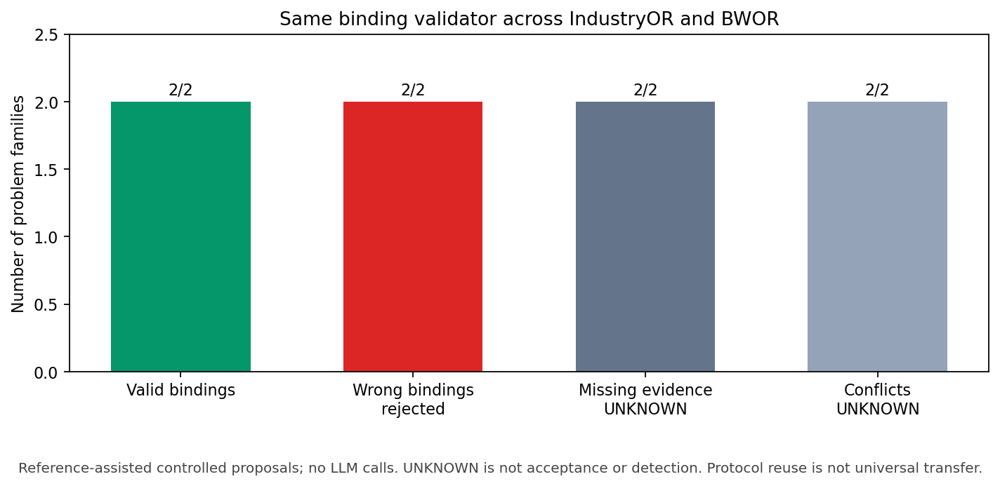

# 可迁移绑定验证层：两族结果 v0.1

状态：reference-assisted 开发与受控反例验证完成；不是 LLM 自动发现、跨族泛化或 SOTA。协议：`binding_protocol_v0.1.md`。

## 1. 结果

同一个 `ora_agent/binding_protocol.py` 和现有 scoped 资产注册表处理两个不同问题族，没有为验证器增加数据集分支。

| 问题族 | 有效绑定 | 错误绑定 | 缺证据 | 冲突提议 | 独立业务评分 |
|---|---|---|---|---|---|
| IndustryOR 数量—指示关系 | validated | rejected | UNKNOWN | UNKNOWN | 通过 |
| BWOR 岗位—完工时间关系 | validated | rejected | UNKNOWN | UNKNOWN | 通过 |

- `accepted_but_business_incorrect=0`；
- 新增 LLM 调用为 0；本轮提议是手工/reference-assisted 和受控输入，不冒充 LLM 自动产生；
- `cold_start_proposal` 只表示来源类型，不能称为 frozen reuse；
- 错误绑定和 UNKNOWN 均不晋升，不修改原候选模型。

制品：`work/binding_validation_v0.1/analysis.json` 及两个 family JSON。`tests/test_binding_protocol.py` 的 7 项测试覆盖两族、来源切片、标签缺失、非法来源、冲突及 reference-clean 缺失。

## 2. 可迁移的究竟是什么

可复用入口为：

```text
BindingProposal
→ 协议/来源检查
→ 现有 scoped 资产编译
→ 独立 clean/wrong 门
→ 可选独立业务评分
→ validated / rejected / unknown
```

`label_source` 是必需项。业务 UNKNOWN 或冲突会阻断选择，即使另一个提议更有利。错误来源、非原文 span、非声明式 payload 和缺失 reference-clean 均不会被静默接受。

`validated` 只表示**当前绑定在已验证作用域内可用**，不等于模型等价、所有实例正确或新域自动理解。两族使用不同的独立业务评价：IndustryOR 的变量/约束/目标/最优性检查，以及 BWOR 的排列、完工时间和子集 DP。

## 3. OR-Agent 源码带来的具体启发

已复核官方 [FlowGraph](https://raw.githubusercontent.com/qiliuchn/OR-Agent/main/src/oragent/flow_graph.py)、[LeadAgent](https://raw.githubusercontent.com/qiliuchn/OR-Agent/main/src/oragent/lead_agent.py)、[ExperimentAgent](https://raw.githubusercontent.com/qiliuchn/OR-Agent/main/src/oragent/experiment_agent.py) 和 [SolutionDatabase](https://raw.githubusercontent.com/qiliuchn/OR-Agent/main/src/oragent/solution_database.py)，补充记录于 `or_agent_reference_review_v0.1.md`。

可借鉴：

- 树状保存局部修复、替代绑定与重新建模，不覆盖父候选；
- 小 diff 与大结构调整分开；
- 按机制、绑定、schema 和失败类型保持候选多样性；
- 按证据进展和不确定性分配实验预算。

不能直接复用：

- 按 score 选叶、只保留优于父节点的孩子和按 score 回退；
- 用程序长度、精英身份或 LLM 置信度替代独立业务证据；
- 按重置弱岛的方式删除失败绑定和负例；
- 任意生成 callback 或 `eval()` 的输出协议；
- 在压缩历史前不保存原始轨迹。

因此，OR-Agent 的树和数据库只能作为**证据门控之后的搜索结构**，不能成为我们的信任来源。没有真实自然修复触发时，仍不运行 DAG 或声称其收益。

## 4. 生命周期与下一步

有效绑定仅标记为 demonstrated scope 内 validated，不自动晋升。错误或 UNKNOWN 保留来源、拒绝原因和原始输入，便于回滚与复核。

下一步优先级：

1. 在具备 LLM 环境后生成 cold-start binding proposal，与 reference-assisted 和文本经验做同初始比较；
2. 用独立标签测量绑定准确率、错误激活、UNKNOWN 和验证成本；
3. 在新族上不改验证器代码，区分冷启动绑定与冻结复用；
4. 只有出现真实修复机会后，才比较单线修复与证据门控的小型候选 DAG。

pre-solve 仍只是可选的工程优化：已验证的绑定可提前减少无效求解，不能代替新域绑定能力的证明。

## 5. 结果图



数值：`docs/paper/figures/binding_validation_v0.1.json`。图中 UNKNOWN 与 rejected 分开，不能合并为“成功检出”。

## 6. 最终验证

- 完整 pytest：**387 passed，47.03s**；
- `m2gen/run_regression.py`：**REGRESSION OK**；
- 两族业务证据、生命周期及实现/输入哈希核对：**PASS**；
- 机器可读记录：`work/binding_validation_v0.1/final_validation.json`。

这里证明的是**验证协议可以跨两类语义复用**，不是 LLM 自动跨族发现、自然修复增益或通用自进化。下一步仍需 cold-start 提议和新族的独立评估。
