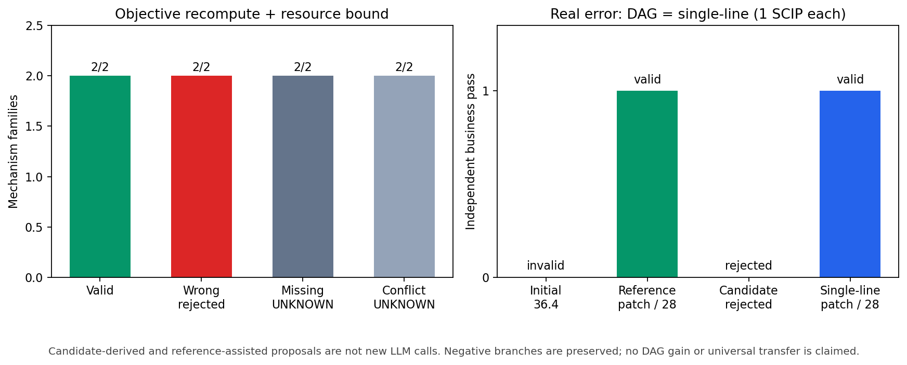

# Cold-start 绑定与真实证据 DAG 结果 v0.1

状态：历史开发与真实自然错误重放完成；不是新 LLM 生成、frozen、通用跨族或 SOTA。协议：`cold_start_binding_protocol_v0.1.md`。

## 1. 两个新机制族

同一个绑定验证入口新增处理 `objective_recompute` 与 `resource_bound`，复用现有 scoped 资产，没有按数据集增加验证分支。

| 机制族 | 有效绑定 | 错误绑定 | 缺证据 | 冲突提议 | 独立业务评分 |
|---|---|---|---|---|---|
| BWOR 目标重算 | validated | rejected | UNKNOWN | UNKNOWN | 通过 |
| IndustryOR 资源约束 | validated | rejected | UNKNOWN | UNKNOWN | 通过 |

有效绑定为 `reference_assisted`。错误项包括从保存候选目标表达式派生的提议和不正确的资源上限；它们不被接受。缺少原文或证据时为 UNKNOWN，有效提议与 UNKNOWN 提议并存时不得选择较有利者。

`accepted_but_business_incorrect=0`，新 LLM 调用为 0。当前未导出 LLM 环境，本轮没有将保存候选或手工提议冒充为新 LLM 冷启动发现。

## 2. 真实自然错误的 DAG 对照

BWOR-058 的自然目标表达式漏掉 `x3_2`，并重复使用 `8.4*x3_3`。初始参考目标为 36.4，正确业务目标为 28.0。

```text
root_initial：自然初始，独立评分失败，保留
├── reference_assisted_objective_patch：真实 SCIP，独立评分通过
└── candidate_derived_binding：绑定被拒绝，保留负证据，不接纳
```

结果：

- `reference_objective_patch` 是唯一能接受的节点；
- 单线修复使用同一目标表达式、同一变量/约束/data/sense，亦通过独立评分；
- DAG 与单线均为 **1 次 SCIP、0 次新 LLM 调用**；
- 两个负分支 `root_initial` 和 `candidate_derived_binding` 均被保留；
- `score_based_pruning=false`。

因此结论是：**证据 DAG 能保留正确分支和负证据，但当前没有 DAG 增量收益。** 这也是 reference-bound 的确定性修复，不是控制器、通用自进化或自主建模证明。

制品：

- `work/cold_start_binding_v0.1/analysis.json`
- `work/cold_start_binding_v0.1/dag.json`
- 每个节点的 candidate hash、parent、action、binding hash、执行、独立评分和成本。

## 3. 迁移与生命周期

有效绑定只在已验证作用域内可用，不自动晋升。错误或 UNKNOWN 不晋升，原始 `root_initial` 和负审计不被删除，支持回滚和复核。

资源约束的独立反例为 510 把椅子超过 500 上限；不是只比较目标值。目标常数项和来源证据已统一进入 `scoped_assets` 编译结果，旧 manifest 因实现哈希变化已重新生成，未忽略哈希差异。

## 4. OR-Agent 结构的落地边界

本轮使用了 OR-Agent 启发的父子候选管理，但只保留：

- 同父分支的假设与动作；
- 不可变负证据；
- 独立业务接受与成本对照。

没有引入按 score 选叶、按长度偏置、弱岛删除或任意生成 callback。DAG 只是证据组织方式，不是自然语言生成能力的替代品。

## 5. 结果图



数值：`docs/paper/figures/cold_start_binding_v0.1.json`。单线与 DAG 的相同恢复和相同成本同时展示，不能只展示成功分支。

## 6. 下一步与验证

下一步应在具备 LLM 环境后，真正生成 cold-start binding proposal，并在未用于机制开发的新族上比较绑定准确率、误激活、UNKNOWN 和成本。真实自然修复触发后，才扩大 DAG 对照。

最终验证：**393 passed，48.25s**；`m2gen/run_regression.py` 输出 **REGRESSION OK**。来源、实现、负分支与单线对照的哈希核验通过。机器可读记录：`work/cold_start_binding_v0.1/final_validation.json`。
