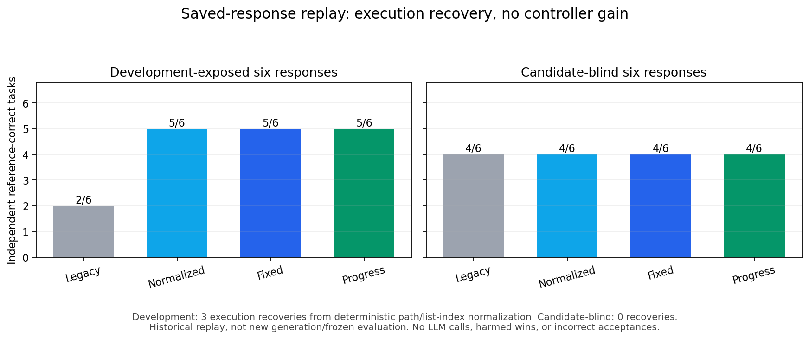

# 输出契约归一化与候选盲评估结果 v0.1

状态：历史开发重放和候选盲历史评估完成；不是新生成、全系统 frozen、通用自进化或 SOTA。

## 1. 同一原始响应，2/6 → 5/6

六个旧 Qwen 响应全部复用，未重新生成、修改 prompt 或挑选候选。v0.1 的变量列表归一化只让 BWOR-002/012 通过外层结构，但分别遇到列表 `lookup.path/index` 不支持、数据路径缺 `data.` 前缀；业务正确仍为 2/6。

v0.2 在 `ora_agent/dvsa_model.py` 增加 `normalize_candidate_paths`：

- 直接数据键只有在候选自身 `data` 中真实存在时才补 `data.` 前缀；
- 只有指向真实列表且索引为合法整数字面量的 `lookup:{path,index}` 才转为 `index:{value,at}`；
- 不补数据、不改约束或目标、不读取答案进行变换；缺失路径、`solution.*` 和非法操作在求解前拒绝；
- 保留原始响应，记录每次转换，公共入口 `scripts/dvsa_candidate.py` 同步使用。

| 指标 | 旧处理 | 当前归一化 | fixed / progress |
|---|---:|---:|---:|
| 独立参考正确 | 2/6 | **5/6** | 5/6 / 5/6 |
| 归一化后的业务恢复 | — | **3** | 0 / 0 |
| 初始求解次数 | 旧历史结果 | 5 | 修复新增 0 / 0 |
| harmed-win / 错接受 | 0 / 0 | 0 / 0 | 0 / 0 / 0 / 0 |
| 新 LLM 调用 | 0 | 0 | 0 / 0 |

BWOR-002、010、012 经独立参考模型与解确认正确。BWOR-005 仍因截断拒绝，不能由内部子对象补全。三个新增正确解全部来自**初始契约/执行归一化**，不是 Witness 语义修复、控制器收益或新 LLM 能力。

制品：`work/bwor_saved_contract_replay_v0.2/analysis.json`；协议：`bwor_saved_contract_protocol_v0.2.md`。旧六题已用于设计归一化，不能称新 heldout。前三题原始 prompt 文件缺失，已在 `missing_source_artifacts` 中保留，未伪造。

## 2. 候选盲历史评估：4/6，零恢复

在查看响应内容或旧评分前，按参考合格 ID 顺序登记 BWOR-013/018/019/021/024/025，冻结 `dvsa_model.py`、replay、scoped loop 和 frozen evaluator 的 SHA256。它们不是本轮新生成，问题也曾用于旧系统，因此只称**当前管线的候选盲历史评估**。

| 指标 | 旧保存评分 | 当前归一化初始 | fixed / progress |
|---|---:|---:|---:|
| 独立参考正确 | 4/6 | 4/6 | 4/6 / 4/6 |
| 归一化后的业务恢复 | — | 0 | 0 / 0 |
| 初始求解 / 修复新增求解 | — | 6 | 0 / 0 |
| harmed-win / 错接受 | 0 / 0 | 0 / 0 | 0 / 0 / 0 / 0 |
| 新 LLM 调用 | 0 | 0 | 0 / 0 |

BWOR-013/018/019/021 保持正确。BWOR-024/025 的目标值虽然匹配，但在原参考变量含义下存在多个机器 A→B 约束违规，因而被 reference-only 评分拒绝，三臂回退。

**勘误（结构和独立排程复核后）**：此前把这些差异直接归因为“真实时序错误”是不准确的。`work/precedence_witness_v0.1/analysis.json` 通过独立排列、结构线性化、A/B 完工时间和子集 DP 复核，确认 BWOR-024 是合法的 cut 表达，BWOR-025 在 `x[position,job]` 绑定下是合法的 completion 表达。两者都应保留，不应修成参考形式。原 4/6 是该 reference-only 口径的结果，不能与新口径的 2/2 直接合并成新的统一准确率。

这也撤回了“需要为这两题制造语义恢复”的推断。控制器仍然没有增量，不能为制造恢复而放宽 gate 或误修合法模型。

制品：`work/bwor_candidate_blind_replay_v0.1/analysis.json`；预注册协议：`bwor_candidate_blind_protocol_v0.1.md`。

## 3. 标签审计

原通用脚本把任意独立评分错误都命名为 `natural_initial_objective_error`，会误导读者的失败归因。已保留原执行制品，并新增 `work/bwor_candidate_blind_replay_v0.1/label_audit.json`：

- 将 BWOR-024/025 标为 `natural_initial_reference_error`，列出真实的 C14…、C25… 等规则；
- 保留原始 wrong、fired、status 和 gate 决策；
- 不重放、不改变行为、零新 LLM 和求解调用。

后续 `bwor_scoped_loop.py` 已区分 objective 与其他 reference 错误，版本为 v0.2；没有用修改后的实现重跑并替代候选盲原结果。

## 4. 结果图与下一步

数值：`docs/paper/figures/contract_recovery_v0.1.json`。左图是已开发响应的 2→5，右图是候选盲的 4→4，不能只展示前者。

下一步需要针对时序/先后关系建立独立变量映射、正反例和 bounded witness，在新的开发族上验证后再评估未见候选。不能直接把本批 BWOR-024/025 调成新资产后仍称候选盲。真正的新自然生成也需要可用 GPU workspace 或已配置的 LLM 环境；当前候选盲重放不替代该实验。

## 5. 最终验证

- 完整 pytest：**354 passed，43.73s**；
- `m2gen/run_regression.py`：**REGRESSION OK**；
- 原始输入、候选盲执行实现、原始 gate 的 SHA256 核对：**PASS**；
- 机器可读记录：`work/bwor_candidate_blind_replay_v0.1/final_validation.json`。
