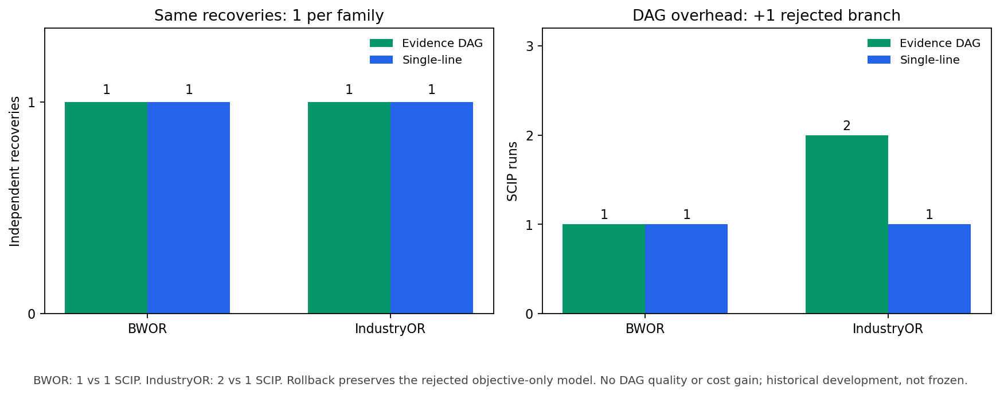

# 完整证据 DAG 与跨族对照结果 v0.1

状态：实现与自然错误对照完成；不是通用进化、frozen 或 SOTA。协议：`cross_family_dag_protocol_v0.1.md`。

## 1. 实现的完整证据 DAG

`ora_agent/evidence_dag.py` 现在支持：

- `dvsa_model` 与 `pyscipopt_code` 候选及完整快照；
- 父节点、子节点、深度、动作、binding hash、执行和独立业务评分；
- 重复 candidate/action/binding 去重；
- 节点数、深度、SCIP 和 LLM 预算；
- done 叶节点、执行失败留痕、真实快照回滚和回滚后重新展开；
- 接受必须同时满足绑定验证、SCIP optimal 和独立业务正确；
- 负分支、回滚事件与 `score_based_pruning=false`。

回滚不是只改一个指针：返回目标快照的深拷贝，保留失败分支，重新打开父节点。`accepted_child` 与 `accepted` 分开，避免把原始错误根节点误记为接受。

## 2. 两族实际结果

| 指标 | BWOR 目标重算 | IndustryOR 目标＋指示约束 |
|---|---:|---:|
| DAG 独立恢复 | 1 | 1 |
| 单线独立恢复 | 1 | 1 |
| DAG SCIP 次数 | 1 | 2 |
| 单线 SCIP 次数 | 1 | 1 |
| 额外 DAG 成本 | 0 | +1 |
| 回滚事件 | 1 | 1 |
| 新 LLM 调用 | 0 | 0 |

`accepted_but_business_incorrect=0`、`harmed_win=0`。

### BWOR-058

原始目标 36.4，candidate-derived 提议被拒绝并保留；reference-assisted 修复后为 28.0。DAG 与单线均为一次 SCIP，没有额外收益，也没有因 DAG 形式造成损失。

### IndustryOR-19

只修目标的分支得到 4000，但解中 `x_B=0、y_B=1`，仍违反指示语义，因此绑定和独立业务评分均拒绝。DAG 回滚到原始模型后，目标＋指示约束组合修复通过，单线同样恢复。

这次拒绝分支真实多花了 1 次 SCIP。**DAG 的价值是保留失败证据并允许安全回滚，不是保证更少求解或更高正确率。**

## 3. 跨族结论

两族都得到恢复，但 DAG 总成本为 **3 次 SCIP**，单线为 **2 次**。因此：

- 有完整的分支管理、回滚和审计能力；
- 没有证明 DAG 的质量增益；
- 没有证明 DAG 的成本优势；
- reference-assisted 修复不是自主跨族发现或自进化。

这也不等于完整 DAG 没有价值：它让“修 A 引入 B”成为可审计、可恢复的过程。下一步若要证明搜索收益，必须在更多自然错误上比较相同总预算下的恢复、误接受与成本，而不是只比较最终成功节点。

## 4. 制品与结果图

- `work/cross_family_dag_v0.1/analysis.json`：两族节点、快照、事件、单线对照和成本；
- `docs/paper/cross_family_dag_results_v0.1.md`；
- `docs/paper/figures/cross_family_dag_v0.1.png`；
- `docs/paper/figures/cross_family_dag_v0.1.json`。

## 5. 最终验证

- 完整 pytest：**408 passed，50.13s**；
- `m2gen/run_regression.py`：**REGRESSION OK**；
- 跨族快照、回滚、成本与实现哈希：**PASS**；
- 机器可读记录：`work/cross_family_dag_v0.1/final_validation.json`。

本轮完成了完整证据 DAG 与跨族验证。结论是：DAG 能可靠管理分支、回滚和负证据，但当前没有质量或成本优势，不能称为通用进化。
