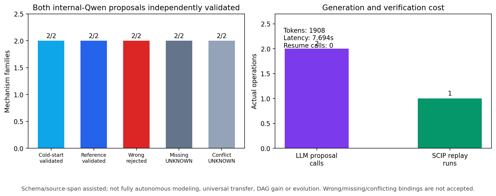

# 内网 Qwen cold-start 绑定验证结果 v0.1

状态：真实内网生成与独立验证完成；不是 frozen、通用跨族、DAG 进化或 SOTA。协议：`internal_cold_start_protocol_v0.1.md`。

## 1. 真实模型调用

模型：`Qwen3_8-27B`（内网 `/v1/models` 确认）。每个机制一次生成，后续环境修复复用原始响应，不修改 prompt、不挑选新答案。

| 指标 | 数值 |
|---|---:|
| 提议生成 LLM 调用 | 2 |
| 后续复用新增调用 | 0 |
| prompt tokens | 1,324 |
| completion tokens | 584 |
| total tokens | 1,908 |
| LLM 总延迟 | 7.694s |
| 后续 SCIP 重放 | 1 |

prompt 只包含自然语言题面、变量声明和允许的原文 span，不包含独立参考约束、目标表达式、参考解或公开答案。因此这是 **schema/source-span assisted cold-start**，不是完全自主变量发现。

## 2. 两个有效绑定

| 机制 | 内网提议 | 独立验证 | reference-assisted 对照 |
|---|---|---|---|
| IndustryOR 目标重算 | x1..x4 分别绑定 15/8/12/5 | validated | validated |
| BWOR 蛋白资源约束 | x1..x5 分别绑定 3/2/1/6/18，`>=700` | validated | validated |

两项都通过 clean/wrong 反例门及独立业务评分，不是根据模型置信度接受。

另外：

- 两个错误绑定均被拒绝；
- 两个缺证据提议均为 UNKNOWN；
- 两个冲突场景均阻止选择较有利绑定；
- `accepted_but_business_incorrect=0`。

制品：`work/internal_cold_start_v0.1/analysis.json`，以及 `objective_recompute/generation.json` 和 `resource_bound/generation.json`。原始 prompt、响应、usage、延迟、解析和业务评分均可复核，API key 未写入制品。

## 3. 验证纪律与反例修正

初次本地验证环境缺少 PySCIPOpt，已切换到项目既有环境，原始目标响应没有重复生成。蛋白反例最初误选 x1，但参考解中 x1 已为 0；改为减少实际使用的 x4，使蛋白确实低于 700，并检查该反例在独立评分下不成立。

这些调整没有修改 LLM prompt 或接受标准，也没有通过挑选响应获得通过。反例的作用是让 Witness 检查真实业务违规，而不是只比较模型目标值。

## 4. 结果图与结论边界

数值：`docs/paper/figures/internal_cold_start_v0.1.json`。

本轮证明：**内网 Qwen 能在给定题面、变量声明和原文跨度下提出正确的结构化绑定，独立验证可以拒绝错误绑定与证据不足。**

尚未证明：

- 没有 schema/source-span 辅助时的自主绑定能力；
- 新族上的普遍迁移；
- 多代、DAG 或自进化收益；
- 优于 reference-assisted 的质量或成本。

下一步若要继续，应使用新族的真实冷启动提议，与 reference-assisted 做同初始比较，并记录验证失败、UNKNOWN 和完整成本。

## 5. 最终验证

- 完整 pytest：**400 passed，48.64s**；
- `m2gen/run_regression.py`：**REGRESSION OK**；
- 内网 prompt、payload、成本、独立业务评分与实现哈希：**PASS**；
- 机器可读记录：`work/internal_cold_start_v0.1/final_validation.json`。

本轮完成的是内网真实 cold-start 绑定提议及独立验证。下一项未完成任务是在未参与机制开发的新族上检验同类提议，而不是宣称已经获得通用迁移或进化能力。
