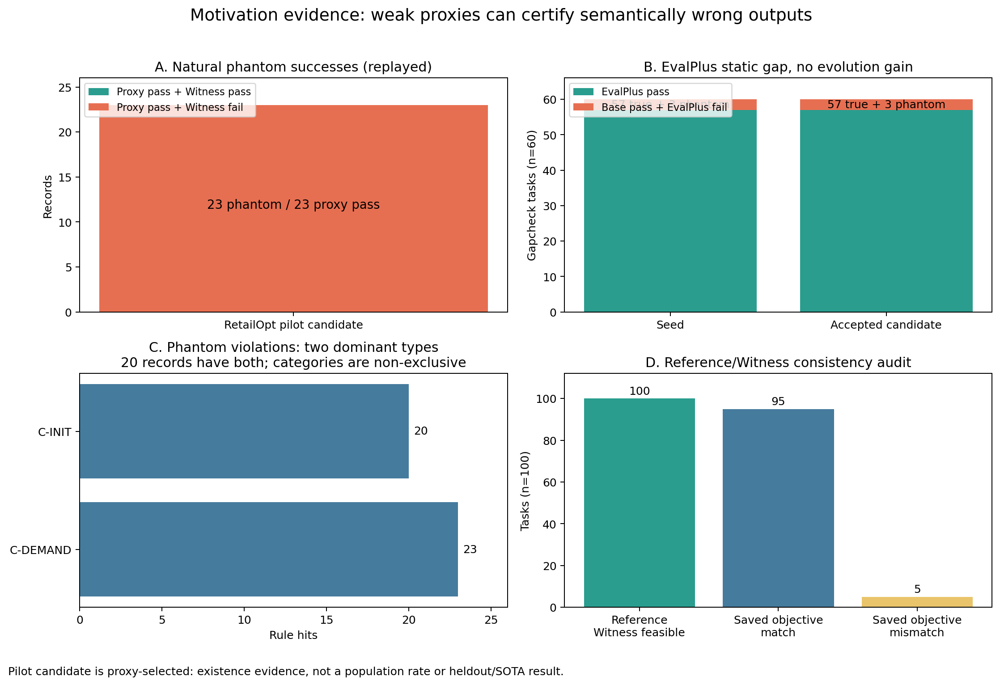

# Motivation：弱代理会认证语义错误的解（v0.1）

## 结论边界

本报告只支持“弱代理与独立强检查会发生分离，幻影成功自然存在”。它不是完整进化放大曲线、总体幻影率估计、跨族 heldout 或 SOTA 结果。RetailOpt 数字来自一个经弱代理优化选出的 pilot 候选，存在明显选择偏差。

## 1. RetailOpt：自然产生的幻影成功

对一个 GEPA pilot 候选的 63 条执行记录：

| 记录数 | 弱代理成功 | 弱代理与 Witness 同时通过 | 弱代理成功但 Witness 失败 |
|---:|---:|---:|---:|
| 63 | 23 | 0 | 23 |

23 条幻影全部重新读取代码和 `solution.json` 并重放 Witness；代码哈希对应记录、解的目标值和违规规则均一致。错误由模型生成过程自然产生，不是人工把正确解篡改成错误解。

违规高度集中，而非覆盖所有语义错误类型：

- `C-DEMAND`：23 条；
- `C-INIT`：20 条；
- 两者同时出现：20 条；仅需求平衡失败：3 条；
- 题族分布：F1=2、F2=6、F3=6、F4=9。

因此，这些记录证明两类业务语义错误可以系统性地被弱代理认证，但不能据此声称已覆盖变量、符号、容量和其他所有建模错误。

原始证据：`work/motivation_phantom_cases_v0.1.json`；逐条重放：`work/motivation_phantom_artifact_audit_v0.1.json`。

## 2. 一个可解释的实例

`retail_f3_storage_bottleneck_v2` 的候选输出：

- SCIP 状态为 `optimal`；
- 输出目标值 `255690.393`，低于保存的参考值 `405046.03`，约低 36.9%；
- 弱代理因此判为 `better_than_reference`；
- Witness 同时报告 `C-INIT` 和 `C-DEMAND`。

具体错误包括：

1. 非新鲜初始库存桶本应为零，但解中出现 `I[SKU_Basic,DC1,1,9]=36.9900` 等未受约束的库存。
2. `SKU_Basic` 在 DC1、第 1 期的需求为 82.75，全部由 `SKU_Premium` 替代满足。`SKU_Premium` 自身需求为 43.25，同时报告销售 43.25。按题面连接关系，其需求平衡为 `43.25 - 82.75 = -39.5`，而不是 43.25。

求解器确实最优地解出了候选代码写下的模型，但该模型的初始库存和替代—需求连接不符合题面。这正是“solver optimal 不等于业务正确”。

## 3. EvalPlus：独立领域的静态弱测试假阳性

在固定的 gapcheck60 上：

| 候选 | 原始测试通过 | EvalPlus 通过 | 原始测试假阳性 |
|---|---:|---:|---:|
| seed | 60/60 | 57/60 | 3 |
| 接受候选 | 60/60 | 57/60 | 3 |

这证明原始测试会漏掉错误实现，但原始测试已经饱和，接受候选没有进化增益。因此 EvalPlus 当前只提供静态跨域对照，不支持动态放大结论。

证据：`work/evalplus_gepa_full_v0.1/analysis.json`。

## 4. Witness 参考一致性审计

对 dev40 + gapcheck60 共 100 题重新求解参考模型：

- 100/100 参考求解状态为 optimal；
- 100/100 参考解通过 Witness，未发现参考解被误判为业务不可行；
- 95/100 重算目标值与保存值匹配；
- `retail_f2_circular_sub` 的 5 个变体重算目标值均比保存值低约 0.99%–1.17%，不是浮点误差。

因此，Witness 与当前参考模型具有内部一致性，但保存的弱代理目标值存在版本噪声。正式 A0 保持冻结的弱代理定义，不中途修改数据；后续分析需对 5 个变体单独做敏感性说明。

这项审计只是“参考模型—Witness 一致性”，不是对所有业务语义的独立证明。两者仍可能共享题面理解盲区，Witness 未编码的规则也不会被发现。

证据：`work/motivation_witness_reference_v0.1/summary.json` 和同目录 `records.jsonl`。

## 5. 当前能与不能得出的结论

可以：

- 可执行、SCIP optimal 和目标值弱代理成功不等于业务正确；
- 自然生成的模型可以系统性地利用初始库存和需求连接漏洞；
- 原始代码测试也会漏掉增强测试能发现的错误；
- 有必要测量弱代理驱动进化中的真实增益与幻影增益。

尚不可以：

- 把 23/23 当成 RetailOpt 总体幻影率；
- 声称 GEPA 已随进化持续放大幻影；
- 声称 Witness 已覆盖所有业务语义或可跨族泛化；
- 声称 R1/R2 已有效、memory 已有效或达到 SOTA。

正式 RetailOpt GEPA A0 仍在运行。下一项关键结果是完整逐代曲线及新增真实 win、继承幻影、新增幻影和修坏 win 的配对分解。
