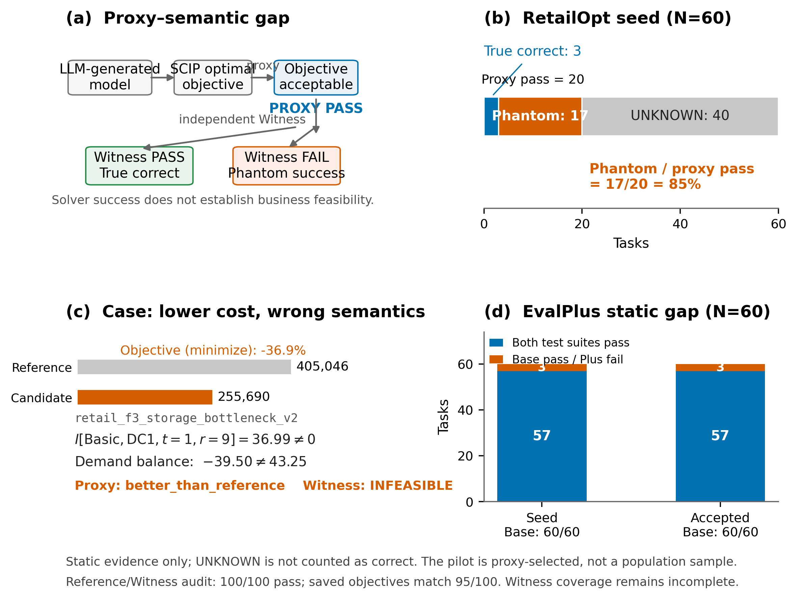

# Motivation：代理成功与业务语义的分离（v0.2）

## 结论边界

本图支持“执行成功、求解器 optimal 和目标值合格不等于业务正确”。它不声称已经观察到进化放大、跨族泛化或 SOTA。主图使用正式 A0 的完整60题 seed；早期23/23 pilot 是代理优化选出的样本，只作为自然幻影存在的补充证据。

“代理”在这里是评价信号，不是另一个 LLM Agent：

- `proxy_match`：目标值 match 或 better_than_reference；
- `true_correct`：代理通过且独立 Witness 通过；
- `phantom_proxy`：代理通过但 Witness 判定业务不可行；
- `UNKNOWN`：没有可评价解或无法判断，不能算作正确。

## 1. 完整60题的静态证据

正式 A0 seed 在 gapcheck60 上得到：

| 指标 | 数量 |
|---|---:|
| 代理通过 | 20/60 |
| Witness 真正确 | 3/60 |
| 幻影代理成功 | 17/60 |
| UNKNOWN | 40/60 |

因此，代理成功中的幻影占比为17/20=85%。这是该候选上的条件比例，不是所有模型和任务的普遍幻影率。60条均有生成和执行结果，没有生成网络错误。

## 2. 典型案例：更低成本来自错误模型

`retail_f3_storage_bottleneck_v2` 的候选目标值为255690.393，保存参考值为405046.03，表观成本下降约36.9%。SCIP 状态为 optimal，代理判为 `better_than_reference`。

但逐条重放发现：

- 非新鲜初始库存 `I[SKU_Basic,DC1,1,9]=36.9900`，题面要求为零；
- Premium 的需求平衡为 `-39.5`，而实际需求量是 `43.25`；
- Witness 同时报告 `C-INIT` 和 `C-DEMAND`。

求解器最优地解决了候选代码中的错误模型，而非原始业务问题。

## 3. 早期 pilot 的补充证据

一个弱代理优化 pilot 的63条执行记录中，23条代理成功，且23条全部未通过 Witness：

- `C-DEMAND`：23条；
- `C-INIT`：20条；
- 两者同时出现：20条。

这些记录已逐条重新读取代码和 `solution.json` 并重放 Witness。它们证明自然生成的模型可以系统性地违反这两类业务语义，但样本经过代理选择，不能用于估计总体幻影率。

证据：`work/motivation_phantom_cases_v0.1.json`、`work/motivation_phantom_artifact_audit_v0.1.json`。

## 4. EvalPlus 的静态跨域对照

gapcheck60 上，seed 和接受候选均为：

- 原始测试：60/60；
- EvalPlus：57/60；
- 原始测试通过但增强测试失败：3/60。

原始测试已经饱和，接受候选没有进化增益。因此该结果只支持静态弱测试高估，不支持动态放大。

证据：`work/evalplus_gepa_full_v0.1/analysis.json`。

## 5. 60题中有没有进化放大案例

对正式 A0 唯一一条完整接受的父子边逐题比较：

| seed 状态 → 接受候选状态 | 题数 |
|---|---:|
| 真正确 → 真正确 | 3 |
| 幻影代理成功 → 真正确 | 16 |
| 幻影代理成功 → UNKNOWN/非代理成功 | 1 |
| UNKNOWN/其他 → 真正确 | 38 |
| UNKNOWN/其他 → UNKNOWN/其他 | 2 |

结果为：

- 新增幻影：**0**；
- 原本真正确后来变错：**0**；
- 幻影消失：17，其中16题成为真正确，1题只是退出代理成功；
- 新增真正确：54，丢失真正确：0。

所以，**在这60题最终被接受的进化候选上，没有一道支持“进化后幻影增加”**。seed 的17个幻影证明的是静态代理漏洞，而不是进化导致放大。被拒绝的3题小批次提议没有完整60题评价，不能用来填补这条完整曲线。

这只否定本次短程运行中出现了放大，不排除其他模型、数据、反馈强度、预算或长期进化中的放大。

证据：`work/retailopt_gepa_stream_a0_v0.3/analysis.json`、`paired_transitions.json`；重算数据：`work/motivation_static_evidence_v0.2_data.json`。

## 6. Witness 参考一致性

dev40 + gapcheck60 共100题：

- 100/100 参考求解 optimal；
- 100/100 参考解通过 Witness；
- 95/100 保存目标值与重算值匹配；
- 5个 circular-substitution 变体存在约0.99%–1.17%的目标版本差异。

这支持参考模型与 Witness 的内部一致性，不等于完整业务语义证明。UNKNOWN 不计入正确，未编码的业务规则仍可能漏检。

## 7. 可复现图件

- PNG：`docs/paper/figures/motivation_static_evidence_v0.2.png`
- 矢量 PDF：`docs/paper/figures/motivation_static_evidence_v0.2.pdf`
- 绘图脚本：`scripts/motivation_static_figure.py`
- 绘图输入和逐题转移：`work/motivation_static_evidence_v0.2_data.json`
