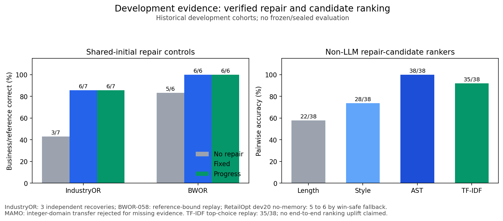

# 下一阶段开发证据：跨域资产、修复控制与轻量排序

状态：本阶段开发证据已完成；不是 sealed/frozen 终验，不是 SOTA 或自动自进化证明。

## 1. 本阶段判定规则

- 至少两个未参与现有 scoped 资产设计的新开发族/域，每个至少六个自然任务。
- 固定修复环与 progress controller 使用共享初始、相同确定性修复器和预算。
- checker 必须通过独立 clean/wrong 反例门；UNKNOWN、部分 rejected、NOT_APPLICABLE 均不能当作接受。
- 只有 checker 接受且独立业务评分也通过才计恢复；无接受候选时回退初始解。
- 记录初始/最终业务正确、恢复、误接受、harmed_win、动作、LLM 调用、token、求解次数与负结果。
- 已经用于开发的数据只称 historical development，不称新 heldout。

## 2. Checker 与候选管理的安全修复

新增 `ora_agent/acceptance.py`：统一 `can_accept(record, checker_status)`，要求 checker accepted、记录 `status=ok`、未触发违规，且 rejected、UNKNOWN、violation、error 等阻断证据均为空。

`ora_agent/scoped_ir.py` 与 `scripts/scoped_ir_gate.py` 现在要求：

- 同时存在 clean 与 wrong；每个 wrong 都触发，每个 clean 都通过；
- `rejected_count=0`、UNKNOWN=0、NOT_APPLICABLE=0；
- 非法 spec/relation、空 cells、部分 invariant 被拒绝均不能形成可信接受；
- VIOLATED 与 UNKNOWN 同时存在时保留违规证据，但不接受；
- 缓存 witness 在提供独立反例时仍需补 gate，不能因 author.json 已存在而跳过。

修复环新增初始候选回退与 `last_candidate_score`：末次未验证候选不覆盖原本正确的初始解，同时保留其独立评分供失败分析。LLM 调用数由实际 authoring/repair 路径记录，不再由分析脚本硬编码。

制品：`work/repair_controller_v0.3/analysis.json`。严格 gate 下，`prob_021` 仍恢复至 81000；本轮实际新增 LLM 调用为 0，固定臂历史修复 token 为 2216，控制臂为 0。它是执行恢复，不是新的自然语义恢复。

## 3. 第六类机制：indicator_link

资产库从五类扩展为六类：

`makespan / objective_recompute / resource_bound / variable_domain / state_conservation / indicator_link`。

新增 `assets/scoped_ir/indicator_link_v0.1.json` 用于整数数量与二元指示变量的双向关系：

```text
indicator <= quantity
quantity <= M * indicator
```

每类指示语义必须有 `source_evidence`：独立参考类型、来源、全文、精确片段和 SHA256。片段不存在、哈希不匹配或缺少证据均拒绝。资产验证包含两个干净解以及 `x=0,y=1`、`x>0,y=0` 两个方向的错误。

六类资产均通过独立验证：错误检出 100%、干净误报 0、UNKNOWN 0。制品：`work/scoped_assets/validation_v0.1.json`。

后续新增第七类 `job_precedence`：同时核对结构关系与返回解，支持位置完工递推和等价 cut 表达，显式记录 `x[job,position]` 与 `x[position,job]` 的作用域。合法等待不等于错误，严格关系使用零容差，多个绑定结论冲突时返回 UNKNOWN。自然复核、受控修复及非晋升记录见 `docs/paper/precedence_witness_results_v0.1.md` 和 `work/precedence_witness_v0.1/`。

## 4. IndustryOR：7 题共享初始对照（v0.6 更新）

### 4.1 数据与独立评分

`assets/industryor_next_stage/manifest.json` 登记 19、20、21、25、48、4、8、9 八题。旧自然 Python 仅追加确定性导出尾部，业务代码未改写，公开答案未注入。

合格题七题：19、20、21、25、4、8、9。48 因缺少各产品加班生产数量，无法复核加班利润扣减，明确排除，不用公开目标匹配冒充变量级业务评分。

独立评分覆盖变量域、业务约束、变量重算业务目标、独立最优性与候选模型目标一致性；API 不返回参考目标值或目标差距。制品：`work/industryor_next_stage_v0.1/`。

### 4.2 失败驱动出的资产组合

最初仅用 objective_recompute 修复 19 的单位成本错误。SCIP 得到 4000 后，checker 接受，但独立业务评分拒绝：`x_B=0` 而 `y_B=1`。该结果保留在 `work/industryor_scoped_loop_v0.1/`，不计恢复。

随后增加独立参考支持的 indicator_link 资产，并让修复器同时：

1. 将每单成本改为“每把椅子/桌子的成本 × 每单数量”；
2. 补齐数量与指示变量的双向约束；
3. 用独立 clean、自然错误、目标错误和两个指示方向反例验证组合资产。

本轮第 20 题复用既有 variable_domain、indicator_link、objective_recompute 模板，不调用 LLM authoring。整数语义引用 ORThought `prob_019/model.txt`，指示关系引用 `code.py`，均保存原文、精确片段和 SHA256。只把 x1..x4 改为整数，不把辅助变量一律整数化。八个验证单元包含独立最优解、自然初始、目标错报、零/正产量、小数产量及两个指示方向错误。修复后真实 SCIP 目标为 956，x2=118、x3=1，其余产量为 0，指示一致，独立评分全部通过。初始目标 960 来自违反业务约束的模型，不能把目标数值下降误判为效果退化。

当前配置：`work/industryor_scoped_loop_v0.6/analysis.json`，缓存键包含输入、资产、实现及执行依赖的哈希。

| 指标 | no repair | fixed | progress |
|---|---:|---:|---:|
| 题数 | 7 | 7 | 7 |
| 初始业务正确 | 3 | 3 | 3 |
| 最终业务正确 | 3 | 6 | 6 |
| 独立语义恢复 | 0 | 3 | 3 |
| harmed_win | 0 | 0 | 0 |
| accepted_but_business_incorrect | 0 | 0 | 0 |
| LLM 调用 / token | 0 / 0 | 0 / 0 | 0 / 0 |
| 本轮 SCIP 求解次数 | 0 | 3 | 3 |

恢复案例：19 的每单/每把椅子成本混淆、21 的每单/每张桌子成本混淆，以及 20 的整数域和指示约束错误。三例均经独立业务评分确认，不是 checker 自证。

25 尚无适用资产，4、8、9 保持正确；四题未强行修复。不适用案例的零 harmed-win 主要是控制流保持原样，不能替代错误绑定或失败修复下的安全性证明。

**归因边界：固定环和 progress 在三例一步修复上完全相同，因此这里证明的是“独立验证资产组合 + 修复器”的效果，不是控制器的额外收益。**

## 5. 非 LLM pairwise repair ranker

制品：`work/repair_ranker_v0.1/` 与 `report.md`。

数据：原始 459 对；去 16 对精确重复，并隔离 21 个 rejected 同样通过 witness/grade 的不可靠方向对，剩余 422 对。train 384 对/90 个 scenario，dev 38 对/10 个 scenario，按 scenario 隔离。

| 模型 | train OOF macro | dev micro | 说明 |
|---|---:|---:|---|
| length-only | 0.678 | 0.579 | 明显模板/长度捷径 |
| style LR | 0.729 | 0.737 | 有 source 分层差异 |
| AST/structure LR | 0.932 | 1.000 | dev 饱和，仅 10 个 scenario |
| TF-IDF LR | 0.939 | 0.921 | 由 train 分组验证选择 |

对 TF-IDF 的 38 个 dev top-choice 重新执行 SCIP/witness：35/38 通过，Wilson 95% CI [0.792, 0.973]。35 个选择 chosen 的候选全部通过，3 个误选 rejected 的候选全部未通过。

这验证了既有候选排序和 top-choice 正确性，**不验证新生成候选、端到端业务提升或自然 heldout 泛化**。AST 的 38/38 也没有被解释为总体确定性。

后续小 JEV/GNN 必须超过强 AST 基线，而不是只赢长度或随机；当前 dev 饱和，需新增更难、独立、多候选评估集。

## 6. Open-Jev-2B 工程冒烟

协议：`docs/paper/open_jev_repair_smoke_protocol_v0.1.md`。

官方 2B checkpoint + Qwen3.5-2B 基座使用固定 revision。数据经官方 `jev.data.validate_records` 验证：612 candidate rows、100 groups、612 unique inputs。

但清洗后 train 只有 25 对/12 个 scenario，calibration 只有 3 对/2 个 scenario，因此只允许 10-step、defer-heldout 的训练/保存/重载冒烟，不允许据此声称自然排序能力或泛化。

冒烟已实际完成：`status=complete`、10 steps、252.36 秒、checkpoint reload max error=0.0，峰值预留显存 10.015625GiB。制品与权重已同步到 `work/open_jev_smoke_v0.1/`。训练第 5、7、10 步出现明显 loss/梯度尖峰，不能写成稳定收敛；校准温度达到 20 且仅由 3 对校准样本拟合，不能解释为能力或安全校准。test/OOD 未参与训练或 checkpoint 选择。

随后对历史 test 的 28 对/10 个 scenario 顺序加载官方 2B 与训练 checkpoint，使用同一 16384 配置和原始 logits：

| 模型 | 正确对 | pairwise accuracy | scenario macro | 输入 token | 评估耗时 |
|---|---:|---:|---:|---:|---:|
| 官方 Open-Jev-2B | 7/28 | 25.00% | 24.50% | 501841 | 74.61s |
| 10-step checkpoint | 9/28 | 32.14% | 30.67% | 501841 | 73.63s |

制品：`work/open_jev_smoke_v0.1/offline_eval_v0.2/metrics.json` 及两份 predictions。两模型输入 token 完全一致，远程/本地 adapter 与 head 的 SHA256 一致。

**结论仅为工程可行，能力不晋升。** 训练后只增加两对正确，且远低于非 LLM 强基线；样本少、历史开发暴露、长上下文超出官方 4096 配置，均不支持泛化或端到端收益结论。OOD 未运行，不扩大同类训练。

资产绑定器的参数训练未启动：当前只有约 30 题/129 个已暴露不变量，按机制和独立来源划分的标签不足，明确属于数据条件不满足，不能用合成样本冒充自然泛化。旧 27B judge 仅见 ep1/ep2 且无完成标记或最佳 epoch 结果，也不追加同类训练。

训练前的官方 prompt/tokenizer 审计发现全部 612 条输入超过 4096，最长 14738 tokens。协议已在执行前改为 16384，只修改派生 checkpoint 的运行时长度字段，不修改官方权重、不筛题、不静默截断。审计制品为远端 `ora_small_jev/runs/token_length_audit.json`。

## 7. BWOR 跨族对照

制品：`work/bwor_scoped_loop_v0.1/summary.json`、`analysis.json` 和 `negative_results.json`。

预筛查八题，按预先规则剔除两题：BWOR-001 的候选/参考变量名、定义域与边界不一致；BWOR-042 缺少独立参考 solution 且已有参考结果标记为 invalid model。未修改标签，最终分母为六题、覆盖六个问题族。

| 指标 | no repair | fixed | progress |
|---|---:|---:|---:|
| 初始独立评分正确 | 5/6 | 5/6 | 5/6 |
| 最终独立评分正确 | 5/6 | 6/6 | 6/6 |
| reference-bound 开发恢复 | 0 | 1 | 1 |
| 第 0 轮原样停止 | 5 | 5 | 5 |
| harmed_win / 错接受 | 0 / 0 | 0 / 0 | 0 / 0 |
| 真实求解次数 | 0 | 1 | 1 |
| LLM 调用 / token | 0 / 0 | 0 / 0 | 0 / 0 |

BWOR-058 的初始目标漏掉 `x3_2`，并错误重复使用 `8.4*x3_3`；修复后包含正确的 `8.4*x3_2`，独立参考目标从 36.4 恢复至 28.0。变量、约束、data、sense 保持不变，真实求解为 optimal。

该恢复是 **reference-bound 开发重放**：业务表达式来自独立参考模型，最终评分使用独立参考解，不是 NL 冷启动或首次自然恢复。其余五题在第 0 轮保持正确。固定环和 progress 相同，因此同样不证明控制器增量。

## 8. 当前验证

本轮完整回归：**346 passed，42.91s**；`m2gen/run_regression.py` 输出 **REGRESSION OK**，生成样例复现手工切片的 50.0/48.0/48.0、PASS/FAIL:W3/FAIL:W3 和 flip pair。记录：`work/witness_scenario_validation_v0.1/final_validation.json`。

本轮协议、结果和 62 个场景见：

- `docs/paper/witness_repair_validation_protocol_v0.1.md`；
- `docs/paper/witness_repair_validation_results_v0.1.md`；
- `work/witness_scenario_validation_v0.1/manifest.json` 和 `scenarios.jsonl`。

其中 38 个场景有独立业务/参考评分，21 个控制器与契约反例全部通过，3 个 MAMO 场景明确保留 UNKNOWN 和拒绝迁移。RetailOpt 的 win-safe 回放、IndustryOR v0.6 与 BWOR v0.2 均使用本轮制品，不以旧结果代替验证。

## 9. 迁移负结果与标签边界

BWOR v0.2 的冻结目标重算模板在六题六族上从 5/6 恢复到 6/6，零新 LLM 调用，五个正确初始原样保留。它仍是 reference-bound 开发重放。

MAMO 的公开目标值匹配不能代替整数域证据。`scoped_ir_mamo_reuse_v0.2` 和 `scoped_ir_mamo_scope_v0.2` 已禁止用自我声明的布尔字段绕过文本/独立参考检查：八题中七个不适用，一个因证据不足拒绝并保留初始解，零资产晋升。旧 v0.1 只保留为历史未晋升观察，不计业务恢复。生命周期：`work/witness_scenario_validation_v0.1/asset_lifecycle.json`。

Witness 作用域标签和完整业务正确性标签分别保存；可行的次优解可以不触发局部 Witness，但不能通过最终业务评分。

## 10. 尚未证明

- 自动发现新机制、自动 memory 进化或 RSI；
- 任意新域零人工绑定；
- 控制策略本身超过固定环；
- 新候选生成后的端到端排序收益；
- 自然 heldout 的跨域泛化与 SOTA。


## 11. 结果图



图由 `scripts/next_stage_figure.py` 直接从 IndustryOR v0.6、BWOR v0.2、RetailOpt win-safe、MAMO v0.2 和排序制品生成，配套数值见 `docs/paper/figures/next_stage_overview_v0.2.json`。左图是共享初始修复对照，右图是历史非 LLM 候选排序；开发集、reference-bound 重放和排序小样本限制均保留。


## 12. 阶段判定

**本轮工程开发验收通过，可以准备另行的冻结评估。** 依据是：RetailOpt 的回退防止一个 harmed-win，IndustryOR 有三个独立评分确认的改善，BWOR 有一个 reference-bound 开发恢复；共享初始下没有 harmed-win 或错误接受，MAMO 的不充分迁移明确判负。

这不等于冻结终验已经完成，也不证明通用自进化。真正终验必须另行预注册未见初始候选、资产版本、controller、预算和评分器，并一次性执行；当前历史 dev/validation 不得改名成 frozen test。

训练可行性判定：

- 非 LLM 排序可继续作为强基线，但尚无新候选生成后的端到端收益证据；
- Open-Jev-2B 的训练/保存/重载和离线对照工程上可复现，能力不晋升；
- 资产绑定器因独立标签不足不启动参数训练；
- 旧 27B judge 因训练未完成、证据通道与覆盖问题不追加同类训练。

后续工作应使用新的自然候选和独立标签，评估控制策略相对固定环的增益，而不是继续调当前 dev。

## 13. 后续：契约归一化与候选盲评估

在完成上述工程验收后，新增 `normalize_candidate_paths`，严格处理真实数据路径和列表索引别名。同一六个已开发响应的独立参考正确数由 2/6 增至 5/6，三个恢复均发生在初始契约/执行阶段，修复环没有新增动作。

另在读取响应和评分前预注册六个历史候选，冻结实现哈希后执行候选盲评估。reference-only 口径结果为 4/6，三臂相同、零恢复、零误接受、零 harmed-win。后续独立排程复核发现，BWOR-024 的 cut 和 BWOR-025 的 `x[position,job]` completion 都是合法替代表达；此前的“真实时序错误”归因予以撤回，不应误修。复核制品为 `work/precedence_witness_v0.1/analysis.json`。

完整报告：`docs/paper/contract_recovery_results_v0.1.md`；结果图：`docs/paper/figures/contract_recovery_v0.1.png`。候选盲标签的事后校正保留在 `work/bwor_candidate_blind_replay_v0.1/label_audit.json`，不重放、不改变决策。上述历史候选仍不称新 frozen 或通用泛化证据。

本后续阶段的最终验证为 **354 passed + m2gen REGRESSION OK**，见 `work/bwor_candidate_blind_replay_v0.1/final_validation.json`；第 8 节的 346 项为前一阶段验收记录。

## 14. 可迁移绑定验证与候选搜索边界

新增数据集无关的 `ora_agent/binding_protocol.py`，将绑定提议、独立标签、现有 scoped 资产编译和业务评分串成统一入口。IndustryOR 数量—指示关系与 BWOR 岗位—完工时间关系均由同一验证代码接受；两个错误绑定被拒绝，缺证据与冲突均为 UNKNOWN，零错误接受、零新 LLM 调用。这里验证的是协议复用，不是 LLM 自动跨族理解或 frozen 泛化。

报告：`docs/paper/binding_validation_results_v0.1.md`；制品：`work/binding_validation_v0.1/analysis.json`。

OR-Agent 的 FlowGraph、LeadAgent、ExperimentAgent 和 SolutionDatabase 源码已复核。可借鉴树状假设、实验诊断与多样性管理，但其 score 选叶、裁剪、回退和岛屿重置不能替代独立业务验收。后续候选分支须保存绑定、来源、执行证据、成本和不可变负例，且只在真实自然修复触发后评估。详见 `docs/paper/or_agent_reference_review_v0.1.md`。

本阶段最终验证为 **387 passed + m2gen REGRESSION OK**，见 `work/binding_validation_v0.1/final_validation.json`。

## 15. Cold-start 提议与真实证据 DAG

新增 `objective_recompute` 和 `resource_bound` 两族绑定验证。reference-assisted 有效绑定均通过独立业务评分，candidate-derived 错误提议被拒绝，缺证据与冲突均为 UNKNOWN，零新 LLM 调用。

BWOR-058 的真实自然目标错误进入小型证据 DAG：reference-assisted 修复与单线修复均通过独立评分且各调用一次 SCIP；初始错误和 candidate-derived 失败分支全部保留。没有按 score 剪枝，也没有证明 DAG 增量。

报告：`docs/paper/cold_start_binding_results_v0.1.md`；制品：`work/cold_start_binding_v0.1/analysis.json` 和 `dag.json`。

本阶段最终验证为 **393 passed + m2gen REGRESSION OK**，见 `work/cold_start_binding_v0.1/final_validation.json`。

## 16. 内网 Qwen cold-start 提议

已使用内网 `Qwen3_8-27B` 实际生成两个结构化绑定：IndustryOR 的 15/8/12/5 目标系数，以及 BWOR 的 3/2/1/6/18 蛋白系数与 700 下限。prompt 只有题面、变量声明与原文 span，不含独立参考约束、目标表达式、参考解或答案。

两个 cold-start 和两个 reference-assisted 绑定均通过独立反例门与业务评分；两个错误绑定被拒绝，缺证据和冲突均为 UNKNOWN，错误接受为 0。实际生成调用 2 次，共 1908 tokens、7.694s；后续复用原始响应，新增调用为 0。结论是 schema/source-span assisted cold-start 可行，不是通用跨族、自进化或 SOTA。

报告：`docs/paper/internal_cold_start_results_v0.1.md`；制品：`work/internal_cold_start_v0.1/analysis.json`。

本阶段最终验证为 **400 passed + m2gen REGRESSION OK**，见 `work/internal_cold_start_v0.1/final_validation.json`。

## 17. 完整证据 DAG 与跨族对照

证据 DAG 已补齐候选快照、父子谱系、分支去重、节点/深度/SCIP/LLM 预算、真实回滚与重新展开。BWOR 和 IndustryOR 均有独立恢复，且错误接受与 harmed-win 为 0。

IndustryOR 的 objective-only 分支目标为 4000，但 `x_B=0、y_B=1`，被独立业务评分拒绝；回滚后组合修复成功。BWOR DAG 与单线均为一次 SCIP，IndustryOR 为两次对一次，说明 DAG 保留失败证据与回滚能力的代价，而非质量或成本增益。

报告：`docs/paper/cross_family_dag_results_v0.1.md`；制品：`work/cross_family_dag_v0.1/analysis.json`。

本阶段最终验证为 **408 passed + m2gen REGRESSION OK**，见 `work/cross_family_dag_v0.1/final_validation.json`。
