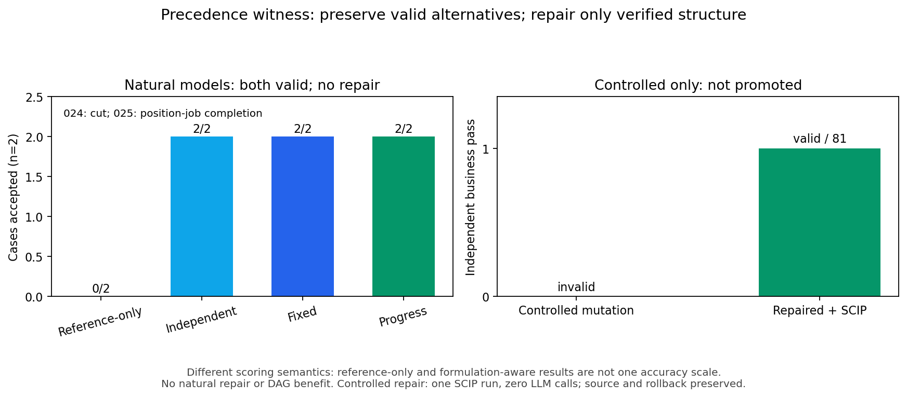

# 结构—解级时序 Witness 结果 v0.1

状态：开发验证完成；不是 frozen、跨族泛化、自然修复提升或 SOTA。协议：`precedence_witness_protocol_v0.1.md`。

## 1. 最重要的结论：两个自然候选都不应修

此前把 BWOR-024/025 的 reference-only 违规直接解释为“真实时序错误”，这一归因已被独立复核推翻。已同步勘误 `contract_recovery_results_v0.1.md` 和 `next_stage_evidence_v0.1.md`，原始候选盲制品未覆盖。

| 自然案例 | reference-only 评分 | 独立结构与解级评分 | 独立最优 makespan | 应采取动作 |
|---|---|---|---:|---|
| BWOR-024 | 不合格 | **合法 cut 表达** | 370 | 保留，不修复 |
| BWOR-025 | 不合格 | **合法 completion 表达，`x[position,job]`** | 81 | 保留，不修复 |

两个参考模型及其解均先通过同一独立评分，随后才评估候选。候选重新执行 SCIP，未读取公开答案作为评分或修复输入。

这给出的研究教训不是“目标正确但业务必错”，而是：**参考变量含义和索引绑定不一致，也可能造成错误拒绝。合法替代模型不能被强行修成参考形式。**

制品：`work/precedence_witness_v0.1/analysis.json`，每题含 candidate、重新执行 solution、binding、audit 和输入 SHA256。

## 2. 机制：结构与解级必须同时成立

`ora_agent/flow_shop.py` 实现：

1. **结构层**：线性化约束并允许正比例缩放、加法交换和等式换边；检查 A 完工递推、A→B precedence、B 相邻位置顺序，或完整 cut 族。
2. **解级层**：从 `x` 还原岗位排列，检查二元域、每个工件和位置恰好一次，独立重算 A/B 完工下界和 makespan。
3. **独立最优性**：小实例枚举验证；自然 6/12 工件使用子集 DP，不依赖公开答案。CB 允许合法等待，不强制等于最早完工时间。
4. **绑定治理**：分别验证 `x[job,position]` 和 `x[position,job]`。只有一个结构绑定成立才采用；多个绑定成立但结论冲突时返回 UNKNOWN，不选择较有利答案。
5. **数据绑定**：支持明确的标量键大小写别名及 `a:[...]/b:[...]` 数组，要求值完全一致；缺失/歧义为 UNKNOWN，错误数值为 VIOLATED。

新增资产 `assets/scoped_ir/job_precedence_v0.1.json`，要求独立来源证据。严格 `>` 使用显式零容差，不将相等误放行；当前 DVSA solver schema 不做严格关系修复。相关资产验证见 `work/precedence_witness_v0.1/asset_validation.json`，七类资产均通过各自的受控验证。

真实 SCIP 对照中，completion 和 cut 模型均达到独立 DP 最优值。反例覆盖提前开始、同目标错误时序、可行次优、错误索引、缺映射、重复/非二元岗位、错误工时、缺 cut 和歧义绑定。

## 3. 共享初始三臂：全部 round-0 保留

| 指标 | no-repair | fixed | progress |
|---|---:|---:|---:|
| 初始独立正确 | 2/2 | 2/2 | 2/2 |
| 最终独立正确 | 2/2 | 2/2 | 2/2 |
| round-0 原样接受 | 2 | 2 | 2 |
| 修复恢复 | 0 | 0 | 0 |
| 确定性变换 / 新增求解 | 0 / 0 | 0 / 0 | 0 / 0 |
| harmed-win / 错接受 | 0 / 0 | 0 / 0 | 0 / 0 |
| LLM 调用 / token | 0 / 0 | 0 / 0 | 0 / 0 |

这意味着**没有自然修复机会，也没有控制器增量证据**。未运行 DAG，不用受控反例伪造 DAG 收益。

控制器另修复一个分类边界：同一 `job_precedence/job_completion/job_machine_sequence` 家族在多个位置重复出现时，不因数量达到阈值就误判为约束爆炸。该改动只有反例验证，尚无自然成本收益证据。

## 4. 窄修复与拒绝晋升

`ora_agent/flow_shop_repair.py` 只在参考 completion 语义明确时替换时间关系：

- 合法 completion/cut 直接拒绝修复；
- 保留变量声明、目标、非时间约束和数据语义；
- 数组时长仅以明确的派生别名补充，不覆盖原始数据；
- 约束 ID 冲突、工时变化、目标变化、映射缺失或结构门失败均拒绝；
- 保存修复前后哈希和回滚来源。

`work/precedence_witness_v0.1/controlled_repair/lifecycle.json` 记录一个**受控** C26 岗位—工件索引交换：两种绑定均不成立，修复后真实 SCIP 达到独立最优值 81，一次求解、零 LLM 调用。原错误模型保留，可恢复。

这只是受控修复验证，登记为 **`not_promoted_controlled_only`**，不算自然恢复，不证明跨族迁移或自进化。

## 5. 结果图

数值：`docs/paper/figures/precedence_witness_v0.1.json`。reference-only 与 formulation-aware 是不同评分语义，不能合成一个新的统一准确率。

## 6. 尚未证明与下一步

- 尚未找到这两个自然实例的真实修复需求；
- 尚未证明跨问题族迁移、控制器增量或候选 DAG 收益；
- 受控错误恢复不能替代自然错误恢复；
- 多数据表示的支持不等于任意新 schema 自动发现。

下一步应在新的开发排程题中寻找真实结构错误，先确认独立标签，再比较 objective-only、precedence+fixed、precedence+progress 和小型 DAG。不得把本批合法候选人为改坏后称为自然案例，也不得重新把 BWOR-024/025 称为候选盲。

## 7. 最终验证

- 完整 pytest：**379 passed，46.08s**；
- `m2gen/run_regression.py`：**REGRESSION OK**；
- 自然评估、三臂、受控修复、回滚与来源/实现哈希核对：**PASS**；
- 机器可读记录：`work/precedence_witness_v0.1/final_validation.json`。

本轮完成的是机制探索与安全边界验证：**没有自然修复提升，也没有 DAG 收益**。这一负结果与受控修复的正结果分别保留，不合并成误导性的性能结论。
