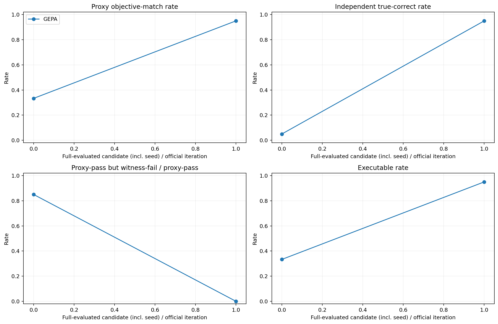
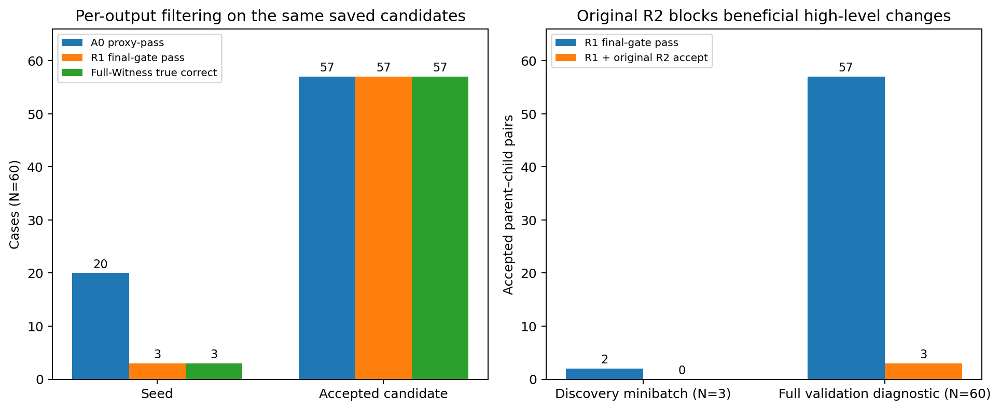

# Verification Governance for Proxy-Driven Optimization Agents

状态：论文骨架 v0.1。本文区分已完成的观测、待完成的对照和未来实验，不把短程结果包装成普遍规律。

## 1. Introduction

自然语言到优化求解系统通常用可执行性、求解状态和目标值匹配指导生成与修复。这些信号成本低，却不能证明模型忠实于原始业务语义。类似分离也存在于代码生成：原始测试通过不等于增强测试通过。

本文研究两个不同问题：

1. 弱代理是否会把语义错误的输出认证为成功？
2. 若系统使用验证知识治理候选，能否减少幻影成功，同时保留真实增益？

我们最初进一步假设：以弱代理为反馈的非参数进化可能逐步放大这种分离。这个假设是可证伪的，而不是论文预设结论。

当前证据支持静态代理高估：RetailOpt 的自然生成中出现了目标值合格但业务检查失败的解；EvalPlus 中也存在原始测试假阳性。RetailOpt 的一次完整短程 GEPA 运行却显示代理与真实正确性共同提高，不支持动态放大。因此当前贡献应聚焦于测量方法和验证治理，不应声称已证明普遍的进化放大。

## 2. Motivation

### 2.1 RetailOpt 静态幻影

既有弱代理优化 pilot 的 63 条记录中，23 条弱代理成功，且这 23 条全部未通过 Witness。这是选择后的条件样本，不是总体幻影率。逐条重放发现 C-DEMAND 和 C-INIT 两类业务语义错误。

典型案例 `retail_f3_storage_bottleneck_v2` 返回 SCIP optimal，目标值比保存参考值低约 36.9%，但存在非零非新鲜初始库存和错误的替代—需求连接。求解器最优地解决了错误模型，而非原始业务问题。

### 2.2 EvalPlus 静态假阳性

gapcheck60 上，seed 和接受候选均为原始测试 60/60、EvalPlus 57/60。原始测试已经饱和，因此这里只支持静态弱测试高估，不支持动态放大。

### 2.3 动态假设与当前负结果

我们在 RetailOpt gapcheck60 上运行官方 GEPA，反馈仅使用执行与目标值弱代理，Witness 只用于事后评价。两个完整接受候选的结果如下：

| 候选 | 代理通过 | Witness 真正确 | 幻影代理成功 | UNKNOWN |
|---|---:|---:|---:|---:|
| seed | 20/60 | 3/60 | 17/60 | 40/60 |
| 第一个接受候选 | 57/60 | 57/60 | 0/60 | 3/60 |

配对上，新增 54 个真实正确解、丢失 0 个；新增 0 个幻影、消除 17 个。一次短程运行、两个接受候选不能排除其他数据、预算、模型或方法中的放大，但足以说明不能把放大当作本项目的既定事实。

## 3. Problem Formulation

对每个候选和题目记录：

- `proxy_match`：目标值 match 或 better_than_reference；
- `true_correct`：代理通过且独立强检查通过；
- `phantom_proxy`：代理通过但独立强检查失败；
- `UNKNOWN`：没有可评价输出或强检查无法确定，不能算作正确；
- 可执行率、token 成本、父子候选关系和真实 win 保留率。

静态问题是代理与真实正确性的分离；动态问题是分离是否沿真实父子边加剧。治理问题则是如何利用有出处的检查和层级接受规则，在降低幻影的同时避免错杀真实修复。

## 4. Method: Verification Governance

### 4.1 R1：按出处授予否决权

候选检查从 `hint_only` 开始。只有具备题面或已验证惯例出处，并在可信 clean/wrong 审计集上满足授权门槛，才晋升为 `veto_enabled`。保存代码哈希、父版本、审计、退休和冻结状态。

R1 将“提出检查”与“允许否决”分开。跨域可以迁移检查模板，但否决权必须在新域重新审计。

### 4.2 R2：按层级接受修复

层级包括 L0 弱代理、L1 执行契约和 L2 独立语义检查。低层修复必须保持所有已授权高层 verdict 逐项不变；高层语义修复应通过显式高层目标进行。

当前原型还要求最终输出通过所有授权检查。这个最终门禁是附加过滤机制，不能与原始 R2 混为一谈。

### 4.3 当前原型边界

多数检查仍是预写的确定性函数，自动的是触发、审计与晋升，不是 LLM 自由生成通用 Witness。R2 的显式高层修复路由尚未完整实现，可能阻止合理的 `fail → pass` 修复。这个风险必须通过固定候选对照量化。

详细设计见 `verification_governance_r1r2_v0.1.md`。

## 5. Experimental Setup

### 5.1 数据与模型

- RetailOpt：dev40 用于训练/小批次反思，gapcheck60 用于方法内验证；F1–F4 覆盖 20 个 archetype。
- 模型：Qwen3.8-27B；求解器：PySCIPOpt/SCIP。
- 官方 GEPA：commit `ce5b0d6e3d6af6c6dbec6de2c54536bbb961d309`。
- A0 预算：240 次 metric calls；seed 全评 60，后续小批次 3，接受候选额外全评 60。
- EvalPlus：dev40/gapcheck60/test64；当前仅 gapcheck 结果用于静态补充。

gapcheck 不是 untouched heldout。F5–F8 的预留数据曾有个别校准接触，严格跨族泛化需要新的冻结评估，当前不宣称 heldout 或 SOTA。

### 5.2 强检查与参考一致性

dev40 + gapcheck60 共 100 题的参考模型均求得 optimal，100/100 参考解通过 Witness。95/100 重算目标值与保存值匹配，5 个 circular-substitution 变体存在约 0.99%–1.17% 的保存目标版本差异。

Witness 与参考模型的一致性不等于覆盖所有业务语义。正式治理分析须区分授权治理检查与最终完整 Witness，避免用同一套进化检查同时充当接受依据和唯一真值。

### 5.3 对照

- A0：官方 GEPA + 弱代理；
- A3 固定候选分析：对同一批 A0 原始输出应用 R1/R2，不重采样；
- 配对指标：新增/丢失真实 win、新增/修复幻影、UNKNOWN、无输出和成本。

固定候选结果不能冒充在线 A3，也不能证明规则对后续进化轨迹的影响。

## 6. Results

### 6.1 静态代理高估：已得到支持

已有自然幻影重放、典型案例和 EvalPlus 假阳性证据。详见 `motivation_static_evidence_v0.2.md`。

### 6.2 动态进化放大：本次未复现

正式 A0 已耗尽 240 次预算，形成两个完整接受候选。代理均值由 0.333 升至 0.950，Witness 真正确率由 5.0% 升至 95.0%，幻影代理成功由 17 降为 0。此次结果与动态放大假设相反。

证据：`work/retailopt_gepa_stream_a0_v0.3/analysis.json`、`paired_transitions.json` 和 `curve_report.md`。

### 6.3 固定候选治理：R1 的局部收益与 R2 的过强拒绝

对同一批 A0 保存输出做事后重放，没有新增 LLM 调用。R1 原型授权执行、初始库存和需求平衡三个检查，完整 Witness 独立用于最终评价。

| 候选 | A0 代理接受 | R1 最终门禁通过 | 门禁拦截幻影 | 门禁错杀真正确 | 门禁误放 |
|---|---:|---:|---:|---:|---:|
| seed | 20 | 3 | 17 | 0 | 0 |
| 接受候选 | 57 | 57 | 0 | 0 | 0 |

在这两个候选上，R1 最终门禁消除了 seed 的全部 17 个幻影代理成功，同时保留了当时的 3 个真实正确输出。该结果只说明小范围内的门禁效果，不证明跨族可靠性。

原始 R2 在官方 discovery 小批次上拒绝了整个有益子候选：3 对中 2 对 R1 最终门禁通过，但 R1+原始 R2 接受数为 0，两个新增真实正确解因高层 verdict 的 `fail→pass` 变化而被拒绝。完整60题的事后诊断中，只有3对同时满足高层不变和最终门禁，54个新增真实正确解会被排除。

因此，R1 的出处授权与最终门禁有初步证据；原始 R2 无法区分合理高层修复和检查洗白，不能直接作为有效在线接受机制。需要显式高层修复路由，而不是简单放宽所有高层不变约束。

证据：`work/retailopt_fixed_candidate_governance_v0.1/analysis.json` 和 `report.md`。

### 6.4 泛化与在线进化：未完成

EvalPlus 仅有静态对照。Text-to-SQL、严格跨族 heldout、多个随机种子、在线 A3 和 R1/R2 独立消融均未完成。

## 7. Limitations and Threats to Validity

1. RetailOpt 与参考模型共享部分语义假设，Witness 未编码的规则仍可能漏检。
2. 五个保存参考目标存在版本噪声，需要敏感性分析。
3. 一次 GEPA 短程轨迹只有两次完整接受候选评估，不足以检验长期进化。
4. 代理提升可能主要来自提示补全、代码/API 错误减少和采样差异，不能直接归因于语义学习。
5. 小审计集仅覆盖三个 F1 archetype，不能证明检查器跨族可靠。
6. 固定候选对照已经暴露 R2 对合理修复的拒绝，但尚不能量化在线轨迹中的长期影响；无输出增加不等于治理成功。
7. 不能把当前数字与之前完整 NL→repair→Witness 工程管线的结果直接比较。

## 8. Next Experiments

按优先级：

1. 完成初稿，主线写为静态代理高估、可审计治理，以及 R2 的过强过滤边界；
2. 设计有明确目标和证据的高层修复路由，区分合理语义修复与检查洗白；
3. 若继续检验动态放大，预注册更长时间、多种子与不同弱反馈强度实验，不根据结果临时挑选口径；
4. 补充独立跨族测试、在线 A3、R1/R2 消融和 Text-to-SQL。

## 9. 当前结论

可以报告：弱代理会认证自然产生的语义错误，需要独立强检查测量；R1 门禁在当前固定候选上拦截了幻影且未错杀真实正确解。

不能报告：动态放大已经得到普遍证明、完整 R1/R2 已有效、跨域成立或达到 SOTA。

本次 A0 提供了明确负结果，固定候选治理又揭示了 R2 的拒绝边界。论文应如实呈现这两个结果，并把“如何区分合理语义修复与检查洗白”列为核心开放问题。
