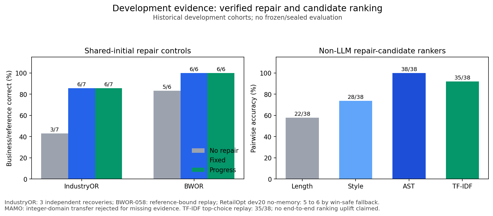

# Witness / 修复框架本轮结果 v0.1

状态：工程开发验收完成；不是 frozen/sealed 终验，不是通用自进化或 SOTA 证明。协议见 `witness_repair_validation_protocol_v0.1.md`。

## 1. 核心结果

| 数据集与口径 | 共享初始 | 本轮结果 | harmed-win / 错误接受 | 新 LLM 调用 |
|---|---:|---:|---:|---:|
| RetailOpt dev20，no-memory | 6/20 | 原修复 5/20 → win-safe 6/20 | 原 1 / 新 0 | 0 |
| IndustryOR 七题，fixed | 3/7 | **6/7，3 个独立业务恢复** | 0 / 0 | 0 |
| IndustryOR 七题，progress | 3/7 | **6/7，3 个独立业务恢复** | 0 / 0 | 0 |
| BWOR 六题六族，fixed/progress | 5/6 | **6/6，1 个 reference-bound 恢复** | 0 / 0 | 0 |
| MAMO mix8，公开目标值口径 | 6/8 | 6/8，0 个资产晋升 | 0 / 0 个接受 | 0 |

这些评分口径不同，不能相加成一个总体准确率。RetailOpt 使用旧 Witness/参考目标口径；IndustryOR 是变量级独立业务评分；BWOR 是参考模型绑定；MAMO 只有公开目标值，不足以证明完整业务正确。

## 2. IndustryOR 第 20 题的新增恢复

原模型将 x1..x4 建成连续变量，且缺少“启用 ⇒ 至少生产一个”的反向链接，得到目标 960 但违反业务语义。初始不是合法但更优的解，因此不能把目标数值高低直接当作质量改善。

本轮复用三个既有模板：

- `variable_domain`：只修改 x1..x4 为整数，不全局整数化；
- `indicator_link`：补齐 `y_i <= x_i` 与 `x_i <= M_i*y_i`；
- `objective_recompute`：保持并核对题面利润 `15/8/12/5`。

整数域证据来自 ORThought `prob_019/model.txt`，指示关系来自 `code.py`，保留精确片段和 SHA256。八个独立验证单元覆盖自然错误、目标错报、零/正产量、小数产量及两个指示方向错误。

真实 SCIP 修复后目标为 **956**，x2=118、x3=1、x1=x4=0，y 与产量一致；独立业务评分无违规。制品：

- `work/industryor_toy_scoped_v0.1/prob_020/fixed/result.json`；
- `work/industryor_scoped_loop_v0.6/analysis.json`；
- `scripts/industryor_scoped_loop.py` 中的窄域修复和独立参考构造。

完整七题从 3/7 到 6/7，三个恢复为 19、20、21；25 仍无适用资产，4、8、9 保持正确。两臂都只有一次确定性修复/题，零 LLM 调用。**因此提升归因于验证资产和修复器，不是 progress controller 的增量。**

## 3. RetailOpt 与成本

`scripts/dvsa_retail_core.py` 的候选选择只在“初始业务正确且候选更差”时回退。`scripts/dvsa_retail_repair.py` 保存末候选评分和回退原因，`scripts/dvsa_win_safe_replay.py` 使用 RetailOpt 对应的 saved replay 和执行恢复结果。

`retail_f2_price_band_tight_v0` 的原本正确解曾被修坏；回退后 no-memory 从 5/20 恢复为 6/20， harmed-win 从 1 降为 0。其余 text-memory、DVSA、direct-legacy 均为 17/20、18/20、17/20，没有新增 harmed-win。回放没有新增 LLM 调用。

制品：`work/dvsa/retailopt_win_safe_v0.1/analysis.json`。这证明候选保护有效，不是四臂之间的质量 superiority 证明。

历史 `prob_021` 的保存轨迹重放还显示：固定臂两次 LLM 修复、2216 repair tokens 仍失败；已知 API 的专用修复零新 LLM 调用恢复执行。它是执行恢复，不是语义恢复或新的自然泛化证据。

## 4. 迁移：一个正向、一个判负

BWOR v0.2 重新执行八题筛查，保留六题六族，两个不合格案例按既有规则排除。fixed/progress 均从 5/6 到 6/6，BWOR-058 的独立参考目标从 36.4 修复为 28.0，其他五个正确初始原样停止。冻结目标模板没有重新 LLM authoring，满足工程复用要求，但不是 NL 冷启动。

MAMO 旧演示曾将食物数量整数化，公开目标值从 71.071 到 72.0；这不能证明整数语义有依据。本轮删除 `independent_validation=True` 的布尔绕过，要求显式文本或可哈希独立参考。

新的 mix8 复核为：七题不适用，一题因缺整数证据而拒绝并保留初始解，零求解、零 LLM 调用、零资产晋升。不能把旧的公开目标值改善计入业务恢复。

制品：

- `work/bwor_scoped_loop_v0.2/summary.json`；
- `work/scoped_ir_mamo_scope_v0.2/analysis.json`；
- `work/scoped_ir_mamo_reuse_v0.2/analysis.json`；
- `work/witness_scenario_validation_v0.1/asset_lifecycle.json`。

## 5. 反例、标签和资产生命周期

`work/witness_scenario_validation_v0.1/scenarios.jsonl` 共 **62** 条：

- 38 条 IndustryOR/BWOR 场景，有独立业务或参考评分；
- 21 条控制器/契约反例，覆盖重复代码、连环错误、误/漏触发、UNKNOWN、problem_id、JSON/schema、约束数量和差异化预算，**21 passed**；
- 3 条 MAMO 迁移负例，缺业务标签时保留 null，UNKNOWN 不能算通过。

Witness 作用域标签与完整业务标签分开：可行的次优解可能不触发局部 Witness，但独立最终评分仍拒绝。`manifest.json` 保存分母、覆盖、实现哈希和成本；逐题结果保存在各自 analysis/result 制品中。

MAMO 生命周期记录包含来源、三个反例、拒绝 gate、回放路径、零成本、负结果和回滚。资产没有进入注册表晋升，旧目标改善没有被删除或改写成成功。

## 6. 最终验证与结果图

完整命令 `...python3.9 -m pytest -q tests --ignore=tests/test_m2gen.py`：**346 passed，42.91s**。

`python3 m2gen/run_regression.py`：**REGRESSION OK**，复现手工切片和 flip pair。机器可读记录：`work/witness_scenario_validation_v0.1/final_validation.json`。

图数据：`docs/paper/figures/next_stage_overview_v0.2.json`。右图是此前的小样本文本/结构候选排序结果，不是本轮端到端增益；TF-IDF 35/38 是保存候选的独立重放。

## 7. 尚未证明与下一步

- fixed 与 progress 在 IndustryOR、BWOR 的一步修复上相同，尚不能声称控制策略优于固定环；
- 没有自动发现新机制、自动 memory 进化或 RSI 的证明；
- 没有任意新域零人工绑定、自然 frozen 泛化或 SOTA 结论；
- RetailOpt 的源评分口径仍需更独立的业务审计；MAMO 需要独立整数域证据，而不是倒推公开答案。

下一阶段应使用未参与开发的新自然候选，预注册资产、预算和评分，再检验控制器的真实增量。优先分析多轮失败上的成本差异，而不是继续在已开发案例上放大局部收益。
