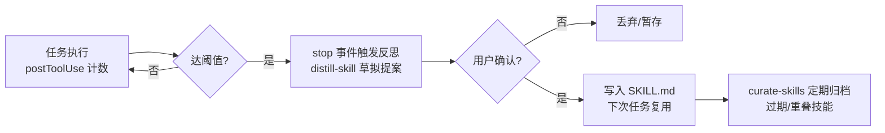

# 3. 路线一：Skill 形态的自进化组件——与用户现有工作流零冲突

第 2 章的全景地图指出，2026 年自进化开源生态呈"哑铃型"：极轻一端是 Skill 形态的补丁式组件，极重一端是权重级训练，中间层的框架级方案反而风险最高。本章讨论哑铃的轻端，也是与用户现状（Cursor + GPT + superpower skill 管理自有工程）贴合度最高的路线：自进化能力本身被做成一个或一组 SKILL.md 目录，以与用户现有 skill 完全相同的方式加载，不需要引入任何独立运行时、服务端或外部依赖，因此与现有工作流零冲突。

## 3.1 Agent Skills 开放标准与运行时兼容性

这条路线的可行性建立在 2025 年底完成的一次标准化之上。Agent Skills 规范由 Anthropic 创建，于 2025-12-18 作为开放标准发布，目前由厂商中立的 GitHub 组织 agentskills/agentskills 治理（Apache-2.0 / CC-BY-4.0 双协议），原 anthropics/skills 仓库中的 spec 文件已替换为指向 agentskills.io/specification 的占位 stub[^25^]。规范的核心约定十分精简：一个技能就是一个目录，必须包含 SKILL.md（YAML frontmatter + Markdown 指令正文），可选 scripts/、references/、assets/ 子目录；frontmatter 共 6 个字段，其中 name、description 必填。规范刻意不包含凭证、MCP 配置或记忆字段，渐进式披露（启动时仅加载约 100 tokens 的元数据，激活时才读正文）是规范的一部分[^25^]。这一点对自进化路线有直接影响：规范层面没有"记忆"的原语，因此所有自进化 skill 都采用"skill + hooks + 工作区文件（.learnings/、AGENTS.md、rules）"的拼装结构实现经验沉淀，这是社区的共识做法而非某个项目的私有设计。

采纳广度方面，截至 2026-06，agentskills.io 客户端展示页列出约 40 个采纳方，覆盖 Claude Code、Claude.ai、OpenAI Codex（~/.codex/skills）、ChatGPT、GitHub Copilot、VS Code、Cursor、Gemini CLI、Goose、OpenCode、Roo Code 等[^27^][^37^][^26^]。对用户而言最关键的事实是：Cursor 2.4 起编辑器与 CLI 均原生支持 Agent Skills，启动时自动发现、由 agent 按 description 判断相关性，也可手动调用；官方还提供 skills-ref validate 参考校验工具[^26^][^28^]。需要注意的是，"跨运行时兼容"只针对规范字段——Claude Code 私有的扩展字段（when_to_use、context 等）在其他工具中会被静默忽略，评估任何第三方 skill 的可移植性时应以其是否只使用规范字段为准[^38^][^39^]。

## 3.2 自进化 skill 代表方案

以下四个方案中，前三个与 superpowers 同形态（SKILL.md 目录，拷入 skills 目录即插即用），第四个为 superpowers 本体，按与用户场景的贴合度排序。其中社区项目的 stars 多为二手数据（2026-08-20 调研当日 GitHub API 限流），均已注明口径。

### 3.2.1 Hermes-Mind-Skill：Cursor 原生 hooks 驱动的反思-沉淀闭环

Hermes-Mind-Skill（JustinGastby/Hermes-Mind-Skill，MIT）是本路线中与用户需求贴合度最高的方案。它专为 Cursor 与 Claude Code 设计，用编辑器原生 Hooks 实现轻量自进化闭环：postToolUse hook 计数，当一次任务中工具调用达到阈值（默认 5 次）时提醒 agent 反思；stop 事件触发时由 distill-skill 草拟一份简短的 Skill 提案，**经用户确认后**才写入 SKILL.md，下次同类任务直接复用；另附 curate-skills 定期体检，将久未使用或重叠的旧技能归档（非删除，可恢复）。实现仅为几十行 Node.js（无 Node 环境时回退到 jq/纯 bash），无服务端、无网络调用，人在回路[^40^][^9^]。Cursor 兼容性为原生级：安装脚本把 hook 拷入 .cursor/hooks/、skill 拷入 .cursor/skills/，且不覆盖已有 hooks.json，而是落一份 \*.hermes-mind-skill.json 供手动合并[^9^]。二次开发入口清晰：调整 THRESHOLD、STALE_DAYS、CURATOR_INTERVAL_HOURS 三个常量即可改变进化节奏，hooks 与 SKILL.md 全文可读可改[^9^]。该项目的"晋升前必须人工确认"设计，正是第 1 章所述 Observe→…→Verify→Retain 自进化闭环（第 10 章概括为 Observe-Verify-Retain 三段式）中 Retain 环节最受工程界认可的形态。该项目较新（2026-07-22 在 ruanyf/weekly 自荐），stars 未查到，影响力数据待观察[^40^]。

图 3-1 Hermes-Mind-Skill 的"反思→确认→沉淀"闭环（流程依据项目官方文档与安装脚本整理[^9^]）

### 3.2.2 pskoett self-improvement：纠错/失败自动记录与规则晋升

pskoett 的 self-improvement skill 走的是事件驱动路线：当发生六类事件——命令意外失败、用户纠正（"No, that's wrong…"）、用户要求不存在的能力、外部 API 失败、agent 发现自身知识过时、发现重复任务的更优解——自动将条目写入 .learnings/LEARNINGS.md、ERRORS.md、FEATURE_REQUESTS.md（带 [LRN-YYYYMMDD-XXX] 编号），在重大任务前回顾，并把可泛化的条目"晋升"到 AGENTS.md、SOUL.md、TOOLS.md 等持久工作区文件[^41^][^42^]。主仓 self-improving-agent 为 OpenClaw 专用；面向 Claude Code、Codex、GitHub Copilot 等的多 agent 版位于 pskoett-ai-skills 仓库（280 stars / 45 forks，2026-08-20 直接打开仓库页实测；OpenClaw 目录显示主仓 17k 下载）[^43^][^41^]。对 Cursor 用户而言，多 agent 版的 SKILL.md 可直接拷入 skills 目录使用，但 hook 部分需按 Cursor 的 hooks 机制自行适配[^43^]。该方案另有衍生项目 RangeKing/self-evolving-agent，在其上升级为"目标驱动能力进化"（增加课程、评估与迁移验证，经验迁入 .evolution/ 目录），适合需要更强验证环的二次开发场景[^44^]。

### 3.2.3 darwin-skill 棘轮式优化器与官方 skill-creator 的 eval 基建

前两个方案解决"经验的产生与沉淀"，darwin-skill（alchaincyf/darwin-skill，2026-04-14 开源）解决"已有 skill 的质量提升"：它把 SKILL.md 当作"可训练资产"，运行五阶段闭环——Evaluate（9 维加权 rubric，满分 100，结合结构检查与实测）→ Improve（每轮只改得分最低的维度，逐轮 git commit）→ Validate（2 个独立子 agent 重新评分 + test-prompts.json 复测）→ Confirm（人在回路审查 diff）→ Keep or Revert（棘轮机制：分数只能上升，退步即 git revert；单轮涨幅小于 1 分自动早停）。其 v2.0 吸收了微软研究院 SkillLens（rubric 评分）与 SkillOpt（验证门控编辑）的设计[^45^][^46^]。安装为 `npx skills add alchaincyf/darwin-skill`，在任何支持 SKILL.md 的宿主中可用；在 Cursor 中作为普通 skill 目录即可运行，因为其优化动作就是编辑文件加 git 操作[^45^]。安全上作者明确要求在 git 仓库内运行并先 commit/stash，且须审查 checkpoint diff，尤其当 skill 涉及 shell、git 或凭证时[^46^]。Anthropic 官方 skill-creator（anthropics/skills 仓库内，示例技能 Apache-2.0）则提供了互补的 eval 基建：访谈意图 → 生成 SKILL.md → 生成测试用例与断言 → 并行跑 with-skill/baseline 对照 → grader 子 agent 评分 → 优化 description 以提升触发召回率（含 train/test split 优化循环）[^47^][^48^]。二者合起来回答了"新 skill 怎么建"与"旧 skill 怎么持续变好"两个问题，其共同前提是第 2 章强调的验证环：没有可自动评分的测试集，进化就退化为随机改写。

### 3.2.4 superpowers 生态及其 meta-skill writing-skills 的自进化边界

用户已在使用的 superpowers（obra/superpowers，MIT）是该生态中影响力最大的项目：stars 采用保守表述为 2026 年 6 月底超 20 万（2026-08-01 第三方目录记录为 265.4k，2026-08-20 skillsllm 首页实测显示 234,966 stars / 20,863 forks，口径不一，取保守值）[^49^][^50^]。必须明确其自进化边界：superpowers 的技能库（Testing / Debugging / Collaboration / Meta 四组）中**没有**"从错误中自动学习"的 skill；与自进化最相关的是 meta-skill writing-skills——教 agent 用 RED-GREEN-REFACTOR 方式创建和测试新 skill：先在无 skill 的压力场景中记录失败行为，再写最小 skill 堵住 agent 的合理化借口，反复重测直到无懈可击[^51^][^52^]。换言之，superpowers 提供的是"人工驱动的 skill 工程方法论"，而非自动经验沉淀；本章 3.2.1–3.2.3 的方案恰好补上自动捕获这一环。二次开发方面，官方一般不接受新 skill 贡献，鼓励用户 fork 后按 writing-skills 规范自建扩展（部署清单、ADR、安全审查、onboarding 等），这对领域专用改进反而是明确的许可信号[^53^]。另需注意 superpowers 默认从官网加载 logo 做使用统计，可用 SUPERPOWERS_DISABLE_TELEMETRY 关闭[^51^]。

## 3.3 本路线对比与接入方式

### 3.3.1 代表方案对比

表 3-1 汇总上述四个方案在机制、兼容性、license 与二次开发方式上的差异。

表 3-1 自进化 skill 代表方案对比（stars 口径见表注）

| 方案 | 核心机制 | 自进化环节 | Cursor 兼容性 | License | stars/影响力 | 二次开发入口 |
|---|---|---|---|---|---|---|
| Hermes-Mind-Skill | 原生 hooks 计数→反思→人工确认→写 SKILL.md | 经验捕获+沉淀（人在回路） | 原生（.cursor/hooks + .cursor/skills） | MIT | 未查到（2026-07 发布，较新）[^40^][^9^] | 调 3 个常量；hooks 与 SKILL.md 全可改 |
| pskoett self-improvement | 六类事件触发→.learnings/ 记录→晋升为规则 | 经验捕获+规则晋升 | SKILL.md 可直接用，hooks 需自行适配 | 见仓库（主仓 OpenClaw-only） | 280★（2026-08-20 实测）/ 17k 下载（二手）[^43^][^41^] | 改触发条件与晋升目标文件；衍生版 RangeKing 可加验证环[^44^] |
| darwin-skill | 9 维 rubric 评分→最低维改进→双 agent 复评→棘轮 git revert | 已有 skill 的质量优化 | 作为普通 skill 目录可用 | 见仓库 | 未查到（2026-04 开源）[^45^][^46^] | 改 rubric 权重与 test-prompts.json；须 git 仓库内运行 |
| skill-creator（官方） | 访谈→生成→with/without 对照→grader 评分→优化触发召回 | 新 skill 的 eval 基建 | 经 `npx skills add` 装入 | Apache-2.0（示例技能） | 母仓 ~149k★（2026-06-11，二手）[^54^][^55^] | 改测试用例与断言模板；多个社区衍生版[^56^] |
| superpowers（对照） | 无自动学习；writing-skills 提供人工 skill 工程方法论 | 无（人工驱动） | `/add-plugin superpowers` 原生安装[^51^] | MIT | 2026 年 6 月底超 20 万★[^49^][^50^] | fork 后按 writing-skills 规范自建 skill[^53^] |

从表 3-1 可见一个清晰的分工：四个方案覆盖自进化闭环的不同环节而非互相替代——Hermes-Mind-Skill 与 self-improvement 负责"从任务中捕获经验"，darwin-skill 与 skill-creator 负责"用验证环提升 skill 质量"，superpowers 则提供承载这些 skill 的方法论底座。影响力数据呈现典型的头部效应：superpowers 以 20 万级 stars 形成事实标准，而承担自动捕获职能的两个社区方案均处于早期（一个 280★、一个无公开 stars 数据），这意味着选择它们需要接受"机制验证充分但维护历史短"的风险，MIT license 与代码量小（Hermes-Mind-Skill 仅几十行脚本）部分对冲了该风险——即使上游停更，fork 维护的成本也极低。兼容性维度上，只有 Hermes-Mind-Skill 做到了 Cursor 原生 hooks，其余方案在 Cursor 中要么降级为"纯 skill 无自动触发"，要么需要用户自行把 hook 逻辑移植到 .cursor/hooks，这是选型时最易被低估的接入成本差异。

### 3.3.2 接入 Cursor 的具体路径

Cursor 2.4 的加载规则决定了接入方式的取舍：skills 自动发现目录包括项目级 .agents/skills/、.cursor/skills/ 与用户级 ~/.agents/skills/、~/.cursor/skills/，并且**兼容读取 .claude/skills/ 与 .codex/skills/（项目与用户级）**——即 Claude 形态的 skill 放进 .claude/skills/ 后 Cursor 直接可见，这为跨工具共享同一套自进化资产提供了官方通道[^28^]。另一个关键机制事实是：聊天中的纠正不会持久化到未来会话，要固化纠正必须写成 rule（"Do X, not Y, because Z" 祈使句式）或 skill——这正是 self-improvement 类方案的晋升目标文件应选择 .cursor/rules/*.mdc 或 AGENTS.md 的原因[^57^][^58^]。

表 3-2 自进化组件接入 Cursor 的方式对比

| 接入方式 | 适用对象 | 具体命令/路径 | 持久化位置 | 特点与限制 |
|---|---|---|---|---|
| 插件市场安装 | superpowers | Agent 聊天输入 `/add-plugin superpowers`[^51^] | 由 Cursor 插件系统托管 | 一键安装、自动更新；自定义改动须走 fork |
| skills CLI 安装 | darwin-skill、skill-creator 等 | `npx skills add owner/repo`[^45^][^55^] | 项目或用户级 skills 目录 | 跨 harness 通用；需自行甄别来源安全 |
| 目录拷贝 | self-improvement 等多 agent skill | 拷入 `.cursor/skills/`（独占）或 `.claude/skills/`（跨工具共享）[^28^] | 随目录位置 | 最通用；hook 部分需另行适配 |
| 原生 hooks | Hermes-Mind-Skill | 安装脚本写入 `.cursor/hooks/`，配置落 `*.hermes-mind-skill.json` 手动合并[^9^] | .cursor/hooks/ + .cursor/skills/ | 唯一实现自动触发的方式；不覆盖已有 hooks.json |
| rules 晋升 | 各方案沉淀出的规则 | 写入 `.cursor/rules/*.mdc`（4 种激活模式）或 AGENTS.md[^57^][^59^] | .cursor/rules/、AGENTS.md | 纠正固化的唯一持久通道；建议纳入 git 管理 |
| /loop 心跳 | 定期回顾与晋升 | Cursor 内置 `/loop` 定时重复跑 prompt 或 skill[^28^] | 会话级 | 模拟 heartbeat 模式，驱动"回顾 .learnings/ 并晋升" |

表 3-2 揭示的结构性事实是：Cursor 侧的接入没有单一银弹，而是一次"分层装配"——skill 目录承载工作流，hooks 承载自动触发，rules/AGENTS.md 承载晋升后的持久知识，/loop 承载周期性回顾。其中 .claude/skills/ 兼容读取是一条容易被忽视的高价值路径：把 self-improvement 这类跨 agent skill 放在 .claude/skills/ 而非 .cursor/skills/，同一份经验资产即可在 Cursor 与 Claude Code 双工具间共享，避免双份维护。需要补充安全前提：skill 生态的供应链投毒是已证实的真实威胁（Snyk 2026-02-05 扫描 3,984 个公开 skill，13.4% 含 critical 级安全问题；2026-01 ClawHavoc 攻击 3 天内出现 341 个恶意 skill）[^60^][^61^]，而自进化系统会把被污染的经验固化进 skill 库长期复用，放大投毒的爆炸半径。因此本路线的落地纪律是：第三方 skill 先经 skillguard/skill-audit 类工具扫描，自进化的写盘动作（沉淀、晋升、棘轮提交）一律保留人工确认环节——表 3-1 中 Hermes-Mind-Skill 与 darwin-skill 均内置了该设计[^60^][^62^]。

综上，本路线今天的可执行装配为：以 superpowers 为方法论底座，叠加 Hermes-Mind-Skill 实现任务后反思沉淀，用 self-improvement 的 .learnings/ 机制捕获纠错并晋升到 .cursor/rules/，再以 darwin-skill 与 skill-creator 对存量 skill 做验证驱动的质量迭代，全部组件开源可二开、与现有工作流零冲突。Skill 形态解决的是经验的"沉淀"；当用户希望对某个 prompt、某条 skill 文本或某段代码做系统性的、有数值指标背书的质量"提升"时，就需要引入下一章讨论的单点优化器路线。
