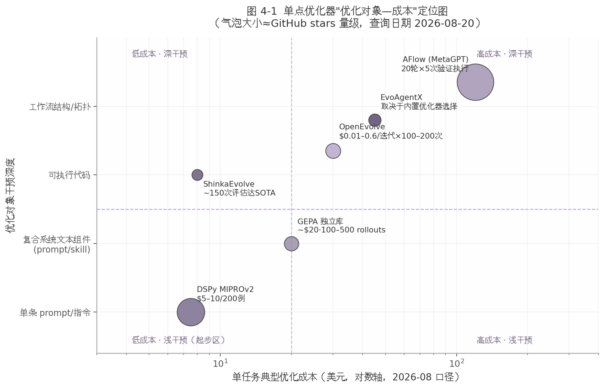

# 4. 路线二：单点优化器——对 prompt/skill/代码做可验证优化

第 3 章讨论的 skill 形态解决的是"经验沉淀"——把已经发生的成功做法保存下来；本章讨论的"单点优化器"解决的是"主动提升"——把 prompt、skill 文本、代码片段、工作流结构当作**可优化的参数**，用一个自动化搜索循环把它们迭代到更高分数。这类工具的共同前提是第 1 章铺垫过的验证环（Insight 2）：所有优化器都要求用户提供一个能返回标量分数的自动评估器（evaluator / metric），"如果你的任务确实没有客观的适应度函数，进化式优化就不是合适的工具"[^63^]。因此本章的接入成本讨论将始终区分两部分：框架本身的安装成本（普遍很低，均为 pip 安装）与验证环的构建成本（真正的大头）。

对"Cursor + GPT + superpower skill 管理工程"的场景而言，关心的不是哪个优化器论文分数最高，而是**哪个能嵌进自己的工程闭环**：优化对象是否覆盖自己已有的资产（prompt 文件、skill 文档、可测试的代码片段）、能否脱离框架独立部署优化产物、许可是否允许二次开发。本章按优化对象从浅到深依次评估六个候选，表 4-1 先给出工程资产到优化器的映射总览。

表 4-1 工程资产 → 可选优化器映射（stars 查询日期均为 2026-08-20）

| 工程中的资产 | 优化对象性质 | 首选优化器 | 备选 | 许可 |
|---|---|---|---|---|
| system prompt / 指令模板 | 单条文本指令 | DSPy MIPROv2（约 3.4–3.7 万★ [^11^]） | GEPA | MIT |
| skill 文档、多模块 prompt 体系 | 复合系统文本组件 | GEPA（6,170★ [^11^]） | TextGrad（已停更） | MIT |
| 可自动测试的代码片段 | 可执行代码 | OpenEvolve（约 7k★ [^64^]） | ShinkaEvolve（约 1.3k★ [^10^]） | Apache-2.0 |
| 多智能体工作流结构 | 拓扑 + 节点 prompt | AFlow（MetaGPT 内） | EvoAgentX（3,242★ [^7^]） | MIT |

这张映射表揭示了一个结构性事实：四个资产层各有明确的"主场选手"，且主场选手之间几乎不重叠——DSPy/GEPA 不处理代码 diff 级进化，OpenEvolve 不以 prompt 为主战场（尽管支持元进化），AFlow 只优化工作流。这意味着选型不是"六选一"，而是"按资产类型各取所需"；真正的决策变量是验证环的成熟度——只有当你的 prompt 背后有一个能自动跑分的测试集时，对应行的优化器才进入可用状态。许可层面则高度整齐：六个候选全部为 MIT 或 Apache-2.0 [^65^][^10^]，二次开发与商用没有许可证障碍，这与第 5 章将讨论的中间层综合框架（多个仓库无 LICENSE）形成鲜明对比，也印证了"哑铃型"生态中"单点优化器属于成熟一端"的判断（Insight 3）。

## 4.1 GEPA：反思式进化优化器

GEPA（Genetic-Pareto，arXiv:2507.19457，ICLR 2026 Oral）是 2025–2026 年影响力上升最快的非权重优化器：独立库 gepa-ai/gepa 达 6,170★（2026-08-20，最近提交 2026-08-19），同时被并入 DSPy 作为 `dspy.GEPA` 内置优化器[^11^][^66^]。其机制是把反思式变异与进化搜索结合：对复合 AI 系统中的每个 prompt 采样 rollout 轨迹（推理链、工具调用、编译器报错等），用一个反思 LLM 诊断失败原因并提出新 prompt；同时维护**逐实例 Pareto 前沿**——不按单一总分排序，而是保留"在不同样本上各有擅长"的候选集合，以此避免单候选贪心法（如 TextGrad 的文本梯度下降）容易陷入的局部最优[^66^][^66^][^67^]。论文报告的关键结果是：在 Qwen3 8B 上以少 35 倍的 rollouts 超过 GRPO（强化学习方法）达 19%，相对 DSPy 上一代默认优化器 MIPROv2 聚合增益 +14% 对 +7%[^66^]。

对二次开发最重要的接口是 **GEPAAdapter**：实现 evaluate 与（可选的）feedback 函数后，GEPA 可以优化"任意文本工件：prompt、代码、agent 架构、调度策略"（2026-02 官方博客 "optimize anything" API）[^67^]。这一点对 superpower skill 场景直接成立——skill 文档本质就是文本工件，可以不经任何框架改写直接作为优化对象；GEPA 官方博客甚至有专文 "Automatically Learning Skills for Coding Agents"[^68^]。样本需求方面，官方 FAQ 称 3 个样本即可起效、建议 30–300 个[^69^]，与第 8 章落地路线图"20–50 条二元 eval 集起步"的口径刚好衔接。

成本是 GEPA 的主打优势。官方 FAQ 给出的 HotPotQA 对照：100–500 次 rollouts、约 20 美元、3 小时，达到 GRPO（5,000+ rollouts、300 美元、24 小时）以上 20% 的效果，即 8 倍快、15 倍便宜[^69^]。局限同样明确：反思质量依赖强反思模型（通常需 GPT-4 级）[^70^]；minibatch 评估存在方差，官方建议按 80/20 或 50/50 划分 train/val 以防过拟合[^69^]。

## 4.2 DSPy：prompt 程序化优化的事实标准

DSPy（stanfordnlp/dspy，MIT）是 prompt 程序化优化领域生态位最稳的方案：stars 存在时间性口径差异（2026-04 外部报道约 2.8 万、2026 年中约 3.4 万、2026-08-20 实抓 37,443），本章按交叉验证结论采用"约 3.4–3.7 万（2026 年中至 8 月）"的区间表述[^11^]；main 分支最近提交 2026-08-18，维护强度在本章所有候选中最高[^11^]。其编程模型把 LLM 调用抽象为 Signature（输入/输出声明）+ Module（Predict/ChainOfThought/ReAct 等），优化器（teleprompter）把"编译"一个程序定义为自动搜索最优 prompt 配置[^71^]。

DSPy 目前提供双优化器。**MIPROv2**（arXiv:2406.11695）三阶段工作：Bootstrap 生成 few-shot 候选、LLM 生成 grounded instruction 候选（可注入数据集描述与 6 类提示词技巧）、再用 Optuna 贝叶斯优化搜索 instruction × demos 的最优组合[^72^][^73^]。**GEPA** 则以 `dspy.GEPA` 内置（依赖 `gepa[dspy]` 包），用户除标量分数外还可提供文本反馈指导优化，"使 GEPA 能在极少 rollouts 内提出高性能 prompt"[^74^]。v3.2 起 `BetterTogether` 支持用策略字符串串联优化器（如 `"p -> w -> p"`：prompt 优化→微调→再 prompt 优化），v3.3（2025-11 发布）加入自定义 instruction_proposer、自定义 component selection 等二次开发入口[^75^]。

接入与部署方面，DSPy 要求把现有逻辑改写为 `dspy.Module`（signature + forward），再调用 `optimizer.compile(program, trainset=..., valset=...)`；优化产物可 `program.save("x.json")` 序列化后**脱离 DSPy 部署**[^71^][^73^]——这意味着它可以作为离线优化管线使用，优化完的高质量 prompt 回灌进 Cursor skill 体系，运行时不需要引入 DSPy 依赖。metric 是任意 `metric(example, prediction) -> float` 函数，工程里现成的测试/评审脚本可以直接复用[^71^]。成本量级：MIPROv2 用 200 个样本约 5–10 美元 API 费用，`auto` 预设分 light（约 7 次试验）/ medium（约 25 次）/ heavy（约 50 次）三档，heavy 档耗时以小时计[^73^][^71^][^76^]。需要注意的局限：2.x→3.0 存在 breaking changes（移除 `dspy.Program` 别名、停止支持 Python 3.9 等），升级需 pin 版本[^77^]；接近模型能力上限的任务收益递减，"并非所有任务都能提升"[^71^]；且 2025 年后的对比研究（CAPO 等）声称可在部分基准超过 MIPROv2 甚至 GEPA，提示"DSPy 默认优化器 ≠ 永远 SOTA"[^78^]。

## 4.3 OpenEvolve 与 ShinkaEvolve：进化式代码优化

当优化对象从文本变为**可执行代码**（例如工程里某个有单元测试的算法函数、数据处理脚本），选型进入 AlphaEvolve 开源复现系。**OpenEvolve**（algorithmicsuperintelligence/openevolve，Apache-2.0）是最活跃的一个：stars 从 2026-05 的约 6.2k 增至 2026-08-20 的约 7.2k，本章按交叉验证口径采用"约 7k（2026-08）"[^64^]。它完整复现了 AlphaEvolve 管线：Program Database 采用 MAP-Elites 质量-多样性进化加岛屿模型并行（防止早熟收敛），Prompt Sampler 组装变异提示，LLM Ensemble 支持任意 OpenAI 兼容 API 与本地模型，Evaluator Pool 异步流水线执行评分[^64^]。

接入形态是 OpenEvolve 的突出强项，官方提供四种：pip 安装、CLI（`python openevolve-run.py initial_program.py evaluator.py --iterations 50`）、可嵌入库 API（`from openevolve import run_evolution, evolve_function`，无需外部文件）、Docker 镜像[^64^]。二次开发的核心是 evaluator：用户提供的独立 Python 函数返回 `{"metric": value}`，附带的 artifacts（stderr、profiling、llm_feedback）会作为反馈注入下一轮 prompt，形成错误反馈闭环；`cascade_evaluation` 支持多级测试提前过滤差程序；MAP-Elites 的特征维度（complexity/diversity/performance/memory_usage 等）可自定义[^64^]。官方成本参考为每迭代 0.01–0.60 美元（Gemini-2.5-Flash 最低 0.01–0.05，o3 最高 0.15–0.60），建议起步 100–200 次迭代，本地模型则近似免费[^64^]。它还具备"元进化"能力：用 OpenEvolve 进化自己的 system prompt，官方 HotpotQA 案例取得 +23% 准确率提升[^64^]——即同一个引擎既能优化代码也能优化 prompt，只是 prompt 优化并非其默认主战场。

**ShinkaEvolve**（Sakana AI，Apache-2.0，约 1.3k★，2026-08-20）主打样本效率：论文（arXiv:2509.19349，2025-09）报告仅用 150 次评估就发现 circle packing 问题的新 SOTA 解，样本效率比同类方法高约一个数量级；机制上依靠探索-利用平衡的父代采样、代码新颖性拒绝采样、bandit 式 LLM 集成选择三项创新[^79^][^10^]。它提供 Hydra 配置启动器与实时 WebUI（进化树/谱系可视化），自定义任务即提供初始程序加 fitness 函数[^80^]。对预算受限场景（例如只有几十美元额度想跑完一次代码进化），ShinkaEvolve 的样本效率是直接优势；其代价是框架更年轻（2025-09 发布）、工程成熟度与社区规模低于 OpenEvolve[^79^]。

## 4.4 AFlow 与 EvoAgentX：工作流结构优化

再深一层是**工作流结构本身**——不只是改节点里的 prompt，而是增删节点、改拓扑。**AFlow**（arXiv:2410.10762，ICLR 2025，内置于 MetaGPT，代码位于 `metagpt/ext/aflow/`）把该问题形式化为代码表示的工作流空间上的 MCTS 搜索：LLM 作为 optimizer 扩展修改工作流代码，执行评估后经验沿树回传；预定义 Operator（Generate/Format/Review/Revise/Ensemble/Test/Programmer）作为构建块[^81^][^82^]。论文报告超过人工设计方法平均 5.7%、超过同期自动工作流优化工作 19.5%，并让小模型以 GPT-4o 的 4.55% 推理成本在特定任务上超过 GPT-4o[^82^]。但接入层面的证据也显示坑位较多：GitHub issue 可见 numpy 序列化报错、自定义 OpenAI 兼容端点 await 报错、非白名单模型模块缺失等问题，**对新模型/自定义 LLM 的适配需要改源码**[^83^]；优化阶段官方总 token 成本未公布，按默认 20 轮 × 每轮 5 次验证集执行的口径推断为数千到上万次 LLM 调用（标注为推断）。领域定制的标准路径是继承 `BaseBenchmark` 实现 evaluate_problem / calculate_score 并注册[^81^]。

**EvoAgentX**（3,242★，2026-08-20，MIT，pip 安装，最近提交 2026-08-14，EMNLP 2025 Demo）则是另一种定位：不做单一算法，而是做**集成底座**——其 evolving 层实际集成 6 个优化器（TextGrad、AFlow、MIPRO、自研 SEW、EvoPrompt、MAP-Elites），可对工作流拓扑、agent prompt、工具配置统一迭代[^84^][^85^]。论文报告的进化收益为 HotPotQA F1 +7.44、MBPP pass@1 +10、MATH +10、GAIA 最高 +20%[^84^]。工程化能力是它的差异化：LiteLLM 多模型接入、内建 benchmark（HotPotQA/MBPP/MATH/GAIA）与评估层、HITL 人工审批拦截器、Docker 沙箱解释器、MCP 工具接入[^7^]；自定义优化器可继承 `optimizer.py` 抽象基类[^85^]。对个人工程的推荐用法与 DSPy 相同——作为**离线进化管线**：用自建 eval set 驱动优化，产出物（工作流模块文件、优化后 prompt）落盘版本化后回灌 Cursor skill 体系，而非替换现有运行时。

## 4.5 本路线对比

表 4-2 汇总六个候选在四个决策维度上的位置，图 4-1 给出"优化对象—成本"的二维定位。

表 4-2 单点优化器对比（stars 查询日期 2026-08-20；成本为该来源标注口径下的单任务典型值）

| 优化器 | Stars | 优化对象 | 接入形态/成本 | 单任务优化成本 | 活跃度（最近提交） |
|---|---|---|---|---|---|
| DSPy (MIPROv2+GEPA) | 约 3.4–3.7 万 [^11^] | 指令+few-shot | pip；需改写为 dspy.Module | 约 $5–10/200 例 [^71^] | 极高（2026-08-18 [^11^]） |
| GEPA 独立库 | 6,170 [^11^] | 任意文本组件（prompt/skill/代码） | pip；实现 GEPAAdapter | 约 $20/100–500 rollouts [^69^] | 极高（2026-08-19 [^11^]） |
| OpenEvolve | 约 7k [^64^] | 可执行代码（兼 prompt 元进化） | pip/CLI/库/Docker 四形态 | $0.01–0.6/迭代，建议 100–200 次 [^64^] | 高（2026-07 [^64^]） |
| ShinkaEvolve | 约 1.3k [^10^] | 可执行代码 | pip + Hydra 配置 | 约 150 次评估达 SOTA（样本效率最高）[^79^] | 中（研究级，2025-09 发布） |
| AFlow (MetaGPT) | 主库 69,904 [^11^] | 工作流拓扑+节点 prompt | 需继承 BaseBenchmark，适配自有模型需改源码 | 未公布；推断数千至上万次调用 | 中（主库 2026-01-21 [^11^]） |
| EvoAgentX | 3,242 [^7^] | 工作流+prompt+工具配置 | pip；离线管线嵌入 | 取决于所选内置优化器 | 高（2026-08-14 [^11^]） |

表 4-2 中最突出的异常值是"接入成本"与"优化成本"的倒挂：AFlow 所在主库 stars 最高（近 7 万），但其子模块接入自有模型时需要改源码，且优化成本最高；GEPA stars 仅为 MetaGPT 的十分之一，却是接入成本最低、成本可预测性最好的方案之一。这说明 stars 反映的是通用生态热度而非"嵌入自有工程闭环"的适配度。活跃度列则给出明确的风险分层：DSPy/GEPA/OpenEvolve/EvoAgentX 四个项目 2026 年 7–8 月仍有提交，构成本路线的"安全集"；AFlow 主库 2026-01 后放缓，ShinkaEvolve 属研究级新发框架，采用时需接受更高的自行维护预期。成本列的口径差异也需强调：DSPy/GEPA 是官方实测美元数，OpenEvolve 是每迭代区间，AFlow 为推断值——横向比较时应视为数量级参考而非精确报价。

图 4-1 单点优化器"优化对象—成本"定位图（资料来源：依据表 4-2 所列各项目官方文档与仓库数据自绘，stars 查询日期 2026-08-20）

图 4-1 把同一批数据投影到"干预深度 × 成本"平面后，可以看到清晰的选型地理：左下象限（低成本·浅干预）的 DSPy MIPROv2 是验证环刚建成时的自然起点；GEPA 占据中线——成本约 20 美元、干预深度覆盖 prompt 与 skill 文本组件，恰好落在 superpower skill 优化的目标区间；ShinkaEvolve 以"低成本·深干预"的异常位置成为预算受限下代码进化的特例；右上象限的 AFlow/EvoAgentX 则提示工作流结构优化的真实门槛——不只是美元成本，还包括验证集要能被工作流端到端执行。沿这条从左下到右上的对角线移动，本质是在用更高的优化预算换取对系统更深层的可改写权。

综合本章证据，对"Cursor + GPT + superpower skill"工程的可执行结论是：**第一步**用 DSPy（或不引入其编程模型、直接 pip 安装 GEPA 独立库并实现 GEPAAdapter）优化现有 prompt 与 skill 文本，单次预算控制在 5–20 美元，优化产物序列化后回灌 skill 体系；**第二步**当工程中出现"有单元测试、值得花算力打磨"的代码片段时，引入 OpenEvolve（预算充足）或 ShinkaEvolve（预算受限）；**第三步**只有当多步 agent 工作流本身成为瓶颈、且验证环已能端到端执行评分时，才考虑 EvoAgentX（省心集成）或 AFlow（接受改源码换论文级算法）。三步共享同一块地基——第 1 章的验证环；每深入一步，验证环要覆盖的执行层级也随之加深，这正是 Insight 2 在优化器选型上的具体投影。
