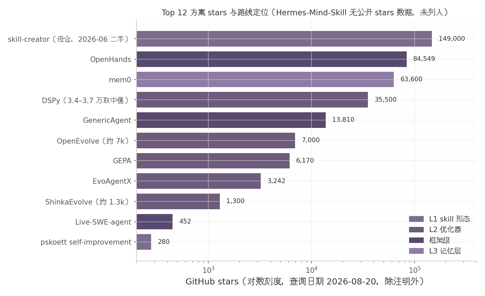

# 8. 综合对比矩阵与选型建议

第 3–7 章沿五层模型逐层评估了候选方案，本章把分散的结论汇总为一张决策矩阵，并给出针对"Cursor + GPT + superpower skill 管理自有工程"场景的推荐组合与落地次序。全章数据口径与前章一致：stars 统一为 2026-08-20 查询值（个别注明二手口径），license 以交叉验证报告清单为准，"即插即用/二开入口/领域定制"三维直接对应第 1 章的三项硬性约束。

## 8.1 总对比矩阵

### 8.1.1 Top 12 方案横向对比

表 8-1 从第 3–6 章评估过的二十余个方案中筛选出 12 个进入终选清单，筛选规则为：license 明确且允许二开（排除 AutoSkill、SWE-RL 等灰区或非商用方案）、机制已获独立验证（排除 Alita 等未释码项目）、与用户工程资产（prompt/skill/代码/记忆）存在直接对应关系。权重层方案（第 7 章）因资源门槛整体出局，不占席位。

表 8-1 Top 12 方案综合对比矩阵（stars 查询日期 2026-08-20，除表内注明外）

| 方案 | 路线归属 | Stars | License | 即插即用 | 二开入口 | 领域定制方式 | 主要风险 |
|---|---|---|---|---|---|---|---|
| Hermes-Mind-Skill | L1 skill 形态 | 未查到（2026-07 发布）[^40^] | MIT | 原生 hooks 装入 .cursor/ [^9^] | 调 3 个常量；脚本全可读 | 晋升目标文件与阈值自定 | 项目新、维护历史短 |
| pskoett self-improvement | L1 skill 形态 | 280★（实测）/17k 下载（二手）[^43^][^41^] | 见仓库 | SKILL.md 直接拷用，hooks 需适配 | 改触发事件与晋升目标 | .learnings/ 六类事件可增删 | 主仓 OpenClaw-only；数据为二手口径 |
| skill-creator（官方） | L1 skill 形态 | 母仓 ~149k★（2026-06 二手）[^54^][^55^] | Apache-2.0 | `npx skills add` | 改测试用例与断言模板 | 自建 eval 集驱动生成 | 只解决"新建"，不管存量质量 |
| GEPA | L2 优化器 | 6,170★ [^11^] | MIT | pip；GEPAAdapter 两函数 [^67^] | evaluate/feedback 接口 | 任意文本工件（含 skill 文档） | 依赖强反思模型；需防过拟合 [^69^] |
| DSPy | L2 优化器 | 约 3.4–3.7 万★ [^11^] | MIT | pip；需改写为 dspy.Module | 自定义 proposer/metric | 私有 trainset/valset | 大版本有 breaking changes [^77^] |
| OpenEvolve | L2 优化器 | 约 7k★ [^64^] | Apache-2.0 | pip/CLI/库/Docker 四形态 | evaluator 返回标量分 | 自有测试即 fitness | 需可执行验证环境 |
| ShinkaEvolve | L2 优化器 | 约 1.3k★ [^10^] | Apache-2.0 | pip + Hydra 配置 | 初始程序 + fitness 函数 | 同上，样本效率最高 [^79^] | 研究级框架，2025-09 才发布 |
| EvoAgentX | L2 优化器 | 3,242★ [^7^] | MIT | pip；离线管线嵌入 | 继承 optimizer 基类 | 自建 eval set + 六内置优化器 | 集成面宽，单点深度不如专用工具 |
| GenericAgent | 框架级 | 13,810★ [^12^] | MIT | pip 安装 | 约 3K 行种子代码可通读 | 技能结晶机制可复刻 | 无强制 eval gate，错误路径可固化 [^12^] |
| Live-SWE-agent | 框架级 | 452★ [^96^] | MIT | 极高（单 YAML 补丁）[^96^] | prompt 补丁 + 反思消息 | 工具序列化复用（论文 Future Work）[^105^] | 弱模型上退化；工具不跨任务持久化 |
| OpenHands | 框架级 | 84,549★ [^98^] | MIT | 极高（产品化） | Extensions 注册中心 | AGENTS.md + 私有 skills | 经验写盘非自动蒸馏 [^99^] |
| mem0 | L3 记忆层 | 63.6k★ [^14^] | Apache-2.0 | MCP 直连 Cursor（`mem0 init --agent`）[^14^] | SDK/CLI 全开放 | 私有对话流即记忆源 | 不做轨迹→规则的程序性提炼 [^128^] |

表 8-1 呈现三个对决策直接有用的结构。其一，license 安全区高度集中于两端：12 个方案中 11 个为 MIT/Apache-2.0，唯一的例外是 pskoett self-improvement（"见仓库"，且 stars 为二手口径，属交叉验证中的 Low Confidence 项，采用时需先自行确认授权）——这再次印证 Insight 3 的"哑铃型"判断：成熟可用的资产聚集在 skill 补丁与单点优化器两端，中间层框架虽有三个入选（GenericAgent/Live-SWE-agent/OpenHands），但全部以"配置补丁"或"小骨架"形态胜出，重型综合框架无一通过筛选。其二，stars 与场景适配度明显脱钩：OpenHands（84.5k★）与 mem0（63.6k★）是通用生态热度最高的两个，但它们解决的是"承载"而非"进化"；真正承担自动进化职能的 Hermes-Mind-Skill、Live-SWE-agent 均不足 500★甚至无公开数据。这意味着选型不能以 stars 排序，而应以"该组件在闭环中承担哪个环节"排序。其三，风险列的分布提示：轻端方案的风险是"维护历史短"，可用代码量小、fork 成本低对冲；优化器的风险是"验证环缺失时白做"；框架级的风险是"错误固化"——三类风险的护栏成本依次递增。

（图 8-1 为本章基于表 8-1 数据自绘，stars 查询日期 2026-08-20，纵轴对数刻度；Hermes-Mind-Skill 无公开 stars 数据，未纳入图中。）

图 8-1 将 12 个方案中 11 个有 stars 数据者按路线着色（对数刻度）。两个观察值得记录。第一，四个路线的 stars 中位数呈"记忆层 > 框架级 > 优化器 > skill 形态"的排序，与落地推荐次序（L1 skill 形态先行）恰好相反——社区热度反映的是通用需求（记忆、完整 IDE agent），而本场景需要的是可嵌入既有工作流的专用组件，二者错位本身是正常的市场结构，不应解读为低 stars 方案质量差。第二，优化器组内部出现明显梯度：DSPy 以约 3.4–3.7 万★ 成为事实标准，GEPA 与 OpenEvolve 处于 6–7k★ 的活跃成长带（最近提交均为 2026 年 7–8 月），ShinkaEvolve 与 EvoAgentX 在 1–3k★ 区间——按第 4 章的"安全集"结论，前四者构成可依赖区间，后两者采用时需接受更高的自行维护预期。

## 8.2 针对用户场景的推荐组合：三层装配

### 8.2.1 L1 经验自进化层 + L2 单点优化层 + L3 记忆层

第 3–6 章的分路线结论收敛于同一判断（Insight 6）：对用户场景，最优解不是任何一个单一方案，而是三个独立层级的装配——每层各选一件主组件，层间通过文件系统与 MCP 解耦，任何一层可单独替换而不影响其余两层。表 8-2 给出完整装配方案。

表 8-2 三层装配方案（主组件均为 MIT/Apache-2.0，stars 查询日期 2026-08-20）

| 层 | 职能 | 主组件 | 接入方式 | 关键二开点 | 可替换件 |
|---|---|---|---|---|---|
| L1 经验自进化层 | 从任务中捕获经验，经人工确认沉淀为 skill/rule | Hermes-Mind-Skill（MIT）[^40^][^9^] | 原生 hooks 装入 .cursor/hooks/ + .cursor/skills/ | 反思阈值、晋升目标文件（.cursor/rules/*.mdc 或 AGENTS.md）[^57^] | pskoett self-improvement（事件驱动路线，280★）[^43^] |
| L2 单点优化层 | 对有自动评分器的资产做数值背书的提升 | GEPA 独立库（MIT，6,170★）[^11^] | pip 安装，实现 GEPAAdapter 两函数 [^67^] | evaluate 函数复用工程现成测试；反馈函数注入领域知识 | 代码片段场景换 OpenEvolve（约 7k★，Apache-2.0）[^64^] |
| L3 记忆层 | 跨会话陈述性记忆的存取与更新 | mem0（Apache-2.0，63.6k★）[^14^] | MCP 直连 Cursor（`mem0 init --agent`）[^14^] | 检索 K 值与多信号排序按"小 K 优先"纪律配置 [^139^][^127^] | Graphiti/Zep（时序失效场景，30.1k★）[^15^] |

三层装配的分工对应 Observe→Verify→Retain 闭环的三个缺口。L1 解决"经验的产生与沉淀"：Hermes-Mind-Skill 的"晋升前必须人工确认"设计，是第 3 章评估中最受工程界认可的 Retain 形态，且其实现仅几十行脚本，即便上游停更，fork 维护成本也极低。L2 解决"已有资产的主动提升"：L1 只能保存"已经发生的好做法"，当需要对某条 prompt 或某份 SKILL.md 做有数值指标背书的迭代时，GEPA 的 Pareto 进化搜索与"任意文本工件"优化能力恰好补位，官方 HotPotQA 对照显示其约 20 美元、3 小时的预算即可超过 GRPO 式方法 20%[^69^]；工程中出现"有单元测试、值得花算力打磨"的代码片段时，同位置平移替换为 OpenEvolve 即可。L3 解决"跨会话的事实记忆"：mem0 以 MCP 形态零侵入挂入 Cursor，承担偏好、决策、环境事实等陈述性记忆，但必须明确其边界——它不做"轨迹→规则"的程序性提炼[^128^]，那一职能由 L1 承担，两层互补而非重叠。

该组合相对单框架方案（如直接迁入 OpenHands 或 GenericAgent）的优势在于演进路径无锁定：三层各自是第 4–6 章"安全集"内维护强度最高或二开成本最低的组件，且全部产物（SKILL.md、.cursor/rules、优化后 prompt、记忆库）都以纯文件或标准协议存在，迁出任何一层都不会造成资产沉没。代价是闭环的"粘合"由用户自己完成——主要是 L1 与 L2 之间"何时把一份 skill 送去优化"的触发规则，这是三层装配中唯一需要自行设计的部分。

## 8.3 渐进落地路线图

### 8.3.1 L0 轨迹埋点 → L1 eval 集 → L2 经验晋升闭环 → L3 优化器纵深

Insight 2 是全报告证据强度最高的结论：自进化的成败取决于验证环而非进化算子，evaluator/eval set 是真正的接入成本[^150^][^63^]。因此落地路线不从"装框架"开始，而从"建地基"开始。需要说明：本节 L0–L3 为落地阶段编号，与 8.2 节三层装配的 L1–L3 层级编号含义不同，勿混淆。表 8-3 给出四个阶段的动作、产出与晋级标准。

表 8-3 渐进落地路线图（周期为个人开发者业余投入口径的估计值，属推断）

| 阶段 | 核心动作 | 产出物 | 晋级标准（通过才进下一阶段） | 参考周期 |
|---|---|---|---|---|
| L0 轨迹埋点 | 在工程中建立任务轨迹的完整记录：会话日志、工具调用序列、成功/失败标记统一落盘入 git | 可追溯的轨迹档案（目录结构 + 命名约定） | 任意一次失败任务能凭档案完整复盘 | 1 周 |
| L1 eval 集 | 从轨迹中挑高频任务，编写 20–50 条二元判断（通过/不通过）的自动评测 [^150^] | 可一键运行的 eval 脚本 + 基线分数 | 现有 prompt/skill 在 eval 集上跑出稳定基线 | 1–2 周 |
| L2 经验晋升闭环 | 装入 Hermes-Mind-Skill（或 self-improvement），经验经人工确认晋升至 .cursor/rules/ 与 SKILL.md；挂载 mem0 MCP | 运行中的 L1+L3 层；首批晋升的规则与记忆 | 晋升条目在后续同类任务中被实际触发复用；eval 分数不退化 | 2–4 周 |
| L3 优化器纵深 | 用 GEPA 对 L1 eval 集覆盖的 prompt/skill 做首轮优化（预算 5–20 美元 [^71^][^69^]）；代码片段引入 OpenEvolve | 数值背书的优化产物，版本化回灌 skill 体系 | 优化后 eval 分数提升且 train/val 划分下无过拟合迹象 [^69^] | 按需迭代 |

路线图的设计逻辑有三点需要说明。第一，L0 与 L1 不引入任何新组件，却有最高的优先级——第 4 章已论证，没有可自动评分的测试集，一切优化器都退化为随机改写；GEPA 官方"3 个样本即可起效、建议 30–300 个"的口径 [^69^] 与 L1 的 20–50 条 eval 集正好衔接，说明该规模足以启动而非仅是过渡。第二，晋级标准全部设计为"可证伪"形式（基线稳定、条目被复用、分数不退化），目的是让每一层在加深之前先证明自己对自有工程有效，而非凭论文数字推进——第 5 章关于 SWE-bench 记忆化争议 [^108^][^109^] 与"Agent Framework Saturation"负结果 [^115^] 均表明，公开基准收益不能直接外推到私有工程。第三，L3 之后没有 L4：权重层（第 7 章）与自我修改代码（第 5.3 节）在本路线图中被有意排除，前者存在 1–2 个数量级的资源差距，后者存在已被官方实证的 reward hacking 风险 [^112^]；若未来确有纵深需求，正确的入口是在 L1 eval 集成熟后，把同一验证环复用于更深层的实验，而非绕过验证环直接进入重型路线。
