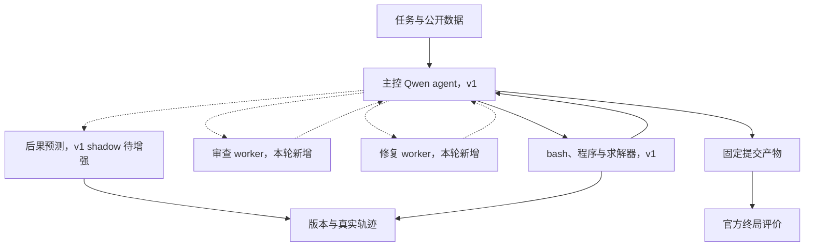
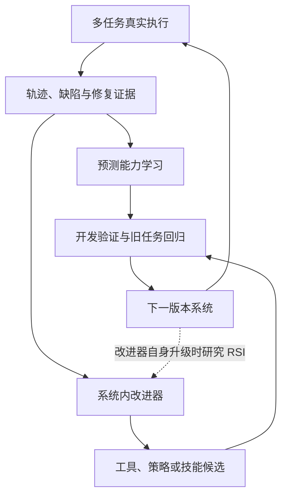

# ORA 第二轮任务书：语义校验、局部修复与过程学习

日期：2026-10-28

本任务接续用户提供的 ORA v1 实现说明。该说明已明确运行时角色、Harbor 接入、旁路预测和已知缺陷；尚不能代替逐任务原始结果或源码审阅。请先以本地真实工程核实，再实施增量。

## 1. 架构决定与状态边界

总目标：

> 通用 OR agent 是系统主体。跨任务动作后果预测是候选核心研究能力。问题内部及求解器内部的 WM 可以作为专业能力继续发展。

第二轮采用一个主控 OR agent，增加按需审查和修复 worker。默认沿用现有 Aliyun MaaS 的 qwen3.8-27b。Kimi 负责开发与实验维护，不在正式运行中替 actor 解题。

worker 第一版可以是共享同一基础模型、使用独立上下文的专门角色调用。它们与独立自主的多步 subagent 分开命名。若实际实现了有限目标、独立历史和工具循环，才记录为 subagent。第一轮不要求重建多 agent 框架，也不要求同时比较所有协作拓扑。

主控负责全局方法与预算、任务状态和最终提交。审查 worker 返回发现、依据和检查建议。修复 worker 返回候选补丁及回归检查计划。主控决定何时调用和采用；实际执行及版本修改由统一执行通道管理。

| 能力 | 根据 v1 报告的状态 | 本轮安排 |
| --- | --- | --- |
| Qwen 主控、bash 循环与 Harbor 执行 | 已有 | 保留并核实 |
| 官方终局评价与 agent 信息隔离 | 已设计/报告实现 | 核对实际环境与调用路径 |
| 事前冻结的旁路预测 | 已有零样本实现 | 扩展输入和后果目标 |
| 显式语义校验、局部修复与回归检查 | 尚无完整协议证据 | 核心交付 |
| 可学习的跨任务预测模型 | 尚未训练 | 导出可信数据与学习接口 |
| 跨任务系统自进化 | 尚未报告实现 | 资源允许时做一个最小原型 |
| RSI | 无已实现证据 | 仅定义扩展接口和未来实验 |

### 任务内架构

节点标记说明实现状态。虚线用于委派或旁路关系，不能据此把已规划能力算作已实现。

审查和修复通过公开代码、数据、模型导出和允许的检查工具获得证据。官方隐藏 evaluator 不作为在线审查工具。预测器当前输出不反馈主控；只有真正接入选择后，才可称为 active 条件。

### 跨任务学习与演化

下图是规划中的外层循环，不能当成 v1 已完成能力。版本选择使用开发验证与旧任务回归；密封测试集不参与反复选择。

任务内修改当前题目的代码属于求解迭代。把经验转成下一批任务可用的能力，才形成跨任务学习/演化。参数更新不是必要条件；可复用程序、提示、检查器或控制策略都可能成为升级对象。

## 2. 给 Kimi 的实施任务

你是 ORA coding agent。请在现有 /home/hewj13/wm/ora 工程中核对实际状态，选择独立分支或其他可恢复方式做增量，保留 v1 结果。

本轮主目标：提高原任务语义忠实度，并将验证与修复变成有真实证据、可供预测和学习的过程。

请自主推进到可运行增量、实际任务结果和研究用数据。设计文档服务实施，不替代实施。不把增加 agent 数量、绘制框架或通过 mock 测试当成主成果。

### 2.1 先核对与修复底座

简短核查实际代码与报告是否一致，重点完成：

1. 补齐所有正常、超时、异常和取消路径的模型用量、状态与已完成产物记录。actor、worker、predictor 的用量分别记录并可合并。
2. 保留初始消息和后续实际消息增量，包括工具错误回注、实际截断字符串、摘要和提示版本。无需每轮重复保存全部历史，但应能准确重建模型看到的上下文。
3. 区分 off 与 shadow 的信息隔离和资源影响。记录预测延迟、共享服务等待、墙钟和额外 token，取消“shadow 等价于零成本基线”的结论。
4. active 尚未接决策时显式标记不支持，或明确按 shadow 处理，不能用名字代替实现。
5. 区分单 bash 命令超时与实际 solver 时间限制，核对程序是否遵守任务协议。不要通过统一缩短所有命令来替代正确限制。
6. worker 共享任务总预算，不能分别继承一整份 40 轮或 2700 秒预算后叠加。根据实际开销调整可配置限制并记录理由。

继续复用 Harbor、现有模型客户端和轨迹代码。Harbor host 与容器 Python 的版本边界要保持清楚，主接入模块尽量维持现有轻依赖做法。

### 2.2 建立轻量的需求与实现对应关系

从公开题面、数据文件、配置与业务规则提取可追溯需求条目。它是检查用侧记录，不强迫所有方案由固定 DSL 生成。

建议字段：

| 对象 | 最低必要内容 |
| --- | --- |
| Requirement | req_id、source_refs、适用对象/范围、单位、硬软属性、明确表达或未决歧义 |
| ImplementationLink | req_id、相关代码/模型/数据处理位置、制品版本、覆盖方式 |
| Finding | finding_id、req_ids、制品 hash、问题类型、证据类型、witness_ref、状态 |
| CheckResult | check_id、被测版本、输入 hash、实际结果、证据来源 |
| RepairResult | 补丁 hash、目标 finding、已检查解决项、确认回归、新发现问题、剩余未知 |

代码或目标变化应使相应旧检查失效；必要时依据依赖关系重查。新增需求解释需要原始公开材料支持，不能把 actor 初次提取结果视为绝对真值。

不要强制“一条需求对应一条 solver constraint”。允许一对多、多对一，以及由原生算法和修复逻辑实现的要求。

### 2.3 实现有证据的审查 worker

审查至少覆盖：

- 原题与数据中的要求是否遗漏，变量域和目标是否完整。
- 方向、量词、索引范围、条件、单位和数据映射是否正确。
- 代码是否实际构建相应约束，不能只检查注释和 model.md。
- 是否增加无来源限制，或者把硬要求改成可付罚金的偏好。
- 最终业务解是否满足原约束，目标能否独立重算。

采用组合证据：代码语义重建、模型导出/检查、微型边界实例、可行/不可行例子、差分或反例测试。选择与当前问题相关且成本合理的检查，不要求每条 bash 后重跑全部审计。

区分证据等级：LLM 判断、实际测试结果、确定性证据或形式化反例。输出可以是 suspected、confirmed、unresolved 或 refuted。未知不计作通过。

对语义重建做一个输入控制：比较有原题上下文与隐藏预期约束表达的重建方式。后者保留必要符号含义、数据与代码，不显示期望的约束方向。测量是否影响已知错误检测，不能先假定哪种必胜。

一条重要的示例：对“B 投资不超过 50”，在其他条件不干扰的微型实例中，B=40 应被该规则允许，B=60 应被拒绝。此类正反例同时帮助发现缺约束和多约束。

正确解通过当前检查，不足以证明模型语义完全正确。修复目标值或得到相同最优值也不自动证明等价。

### 2.4 实现局部修复与回归

修复 worker 接收原始要求、当前制品、具体发现及证据，提出有针对性的补丁。允许修改 formulation、代码、数据处理或算法；不改变原任务的判定标准。

区分实现错误、语义错误、可行解构造困难和解质量不足，反馈路由到对应层次。局部改动优先，但必要时允许有理由的整体重构；改动范围本身不是正确性的保证。

补丁在候选副本或可恢复版本上应用，再执行相关检查和必要回归。记录实际结果，保留原版本。主控负责采用、继续修复或恢复。

区分：

- resolved_known：已知问题在可比检查下得到解决。
- confirmed_regression：父版本通过某项可比检查，子版本失败。
- newly_discovered：本轮才发现的问题，未证明由补丁新引入。
- unresolved：缺少足够证据或仍未解决。

审查后发生的拼装、debug 和代码重写同样可能使旧语义证据失效，要重新检查受影响部分。

### 2.5 用受控缺陷检验审查与修复本身

建立一个小型、可执行的开发测试集合，用来检验 verifier，不能只凭 LLM 自评。

选若干不同结构的小问题，例如分配、网络流、带逻辑或时序约束的问题；加入多文件数据映射的例子。每类保留：

- 经独立核验的正确实现。
- 已确认改变含义的语义变异。
- 合法等价改写或不同实现作为负对照。

优先考虑方向、遗漏/额外约束、整数性、索引范围、单位、目标项或数据读取错误。不是每次文本改动都会改变问题；等价或无法确认的变异不能当作确定错误。

为确定错误构造具体 witness 或其他独立标签。标签、参考实现和变异位置只存在于评价侧，不暴露给被测审查/修复角色。

按原始问题及其变体分组划分，避免同源变异跨训练和测试。先得到小型有效集合，再决定是否扩大，不以堆积低质量变异数量为目标。

测量正确制品误报、错误检出、定位、修复成功和回归。模型声称“修复成功”不能替代实际测试。

### 2.6 在真实 ORAgentBench 开发任务上评估

复用现有固定开发任务，保留 v1 配置和产物，再开展小规模比较：

| 条件 | 能力 | 用途 |
| --- | --- | --- |
| B0 | 现有完整 OR agent，自主执行与修复 | 强基线，不人为禁止其自检 |
| B1 | B0 加通用反思/检查调用 | 区分额外推理预算的收益 |
| B2 | 显式语义审查、证据化修复与回归 | 本轮核心实现 |
| B3 | B2 加预测驱动的检查/修复选择 | 仅在真正接入 active 后运行 |

第一轮先完成可信的 B0 与 B2；资源允许再补 B1。B3 可以本轮完成，也可在旁路数据足够后推进，不能把 TODO 当成已实现实验臂。

同一 actor 模型、公开信息、工具权限与总预算下比较。把 worker、预测和检查求解器的全部开销计入；无额外模块的基线可将节省资源用于正常求解。

官方隐藏 verifier 只在提交固定后执行。任何在线审查或修复不能读取 tests、reference、隐藏指标，或者通过反复官方评分指导同一次任务。新的 held-out 分组在读取、训练、检索或用于版本选择前固定。

质量按原业务决策和目标比较。评估包括有效产物、可行性、官方质量/通过率、时间和全部模型/求解成本。开发小样本可以支持实施选择，不能支持跨任务普遍优越的结论。

### 2.7 将旁路预测扩展到验证与修复后果

输入要包含与动作相关的需求、具体制品、既有发现、实际检查和预算。不要只依赖最近八行动作摘要；可以按需选择相关原文与文件，并保留来源和版本。

预测在执行前冻结，记录实际输入、模型/提示版本和具体动作 hash。精确已知的文件修改不必由模型猜测。

按动作选择输出：

- 检查动作：预计会出现的观察或发现、可能仍无法区分的解释。
- 修复动作：哪些已知问题可能解决、潜在回归、执行后的关键状态。
- 求解动作：有效解和质量改善、失败方式、资源消耗。
- 所有动作：unknown、预测范围和适用条件。

将“预测审查器会给出什么判断”与“预测经独立测试确认的错误”分开。LLM 审查发现不能直接作为真实语义错误标签。

继续采集同状态不同候选的实际分叉，保留预测不看好的动作样本。分叉额外执行是离线数据成本，不能作为在线免费 oracle。快照不复制 solver 内存，重启开销如实记录。

当前零样本预测是基线。基于真实轨迹进行检索、SFT/LoRA 或程序归纳的路线可以规划，但本轮不把大规模训练作为工程前提。若执行训练，单列参数更新、数据分组、训练成本、独立测试与旧任务保留。

### 2.8 最小跨任务自进化原型

本部分是后续优先项；若核心闭环已稳定，可用严格受限的一次版本升级试验实施。它不能挤占必要的真实任务验证。

让系统内的 Qwen 改进角色从开发轨迹提出一个可复用能力，例如检查模板、修复技能、工具辅助函数或调用策略。Kimi 提供基础设施，不为每个测试题手写答案。

将候选应用于新版本，在相同开发预算下与原版本比较，并检查旧任务回归。只有获得支持才采用到后续任务；没有改进也如实记录。把候选、作者角色、修改对象、选择依据和应用任务串起来。

若某项升级由 Kimi 手工提出或修改，记录为外部研发。任务内修改当前 solve.py 不计作跨任务自进化。

评测规则、原任务要求、隐藏 verifier 与资源记账不随候选能力一起改变。开发验证用于选择，密封测试用于最终评价，不把反复查看测试当作持续提升。

本轮最多需要证明一个可复用能力能被系统提出、验证和保留，不需要同时实现参数训练、程序种群和完整元优化平台。

## 3. RSI 的研究边界

本文采用较强的可操作判据区分术语，文献中的 RSI 用法并不统一：

| 行为 | 当前更合适的命名 |
| --- | --- |
| 同一题修改 formulation 或 solve.py | 任务内搜索与修复 |
| 真实经验更新预测器参数 | 持续学习 |
| 系统提出并保留对新任务有用的工具/策略升级 | 系统级自改进 |
| 升级后的系统也更善于产生后续升级 | RSI 的候选证据 |

将“改进器自身”列为升级对象，才进入本项目的 RSI 扩展。例如，改进器的测试生成、问题定位、候选产生或验证能力被改善，新版参与下一轮系统改进。

未来实验应从相同初始系统或同一组可比起点出发，用相同改进预算比较旧改进器与新改进器，重复多条升级轨迹，最后在独立任务上评价所得系统。最终解题分数上涨本身不足以隔离“更善于改进自己”的贡献。

本轮不要求完成 RSI 实验，不在报告中写“已经建立 RSI 系统”。固定外部 Kimi 持续开发 ORA，也不能单凭多轮开发就证明运行时 ORA 获得了递归自改进能力。

## 4. 论文工作线与相关工作边界

建议把“工程能力”和“候选论文机制”分别记录。实现一个更可靠的 OR agent 有独立价值；论文需要检验明确的新问题和机制。

优先候选问题：

> 在跨类型自然语言 OR 任务中，学习预测验证与修复的观察和状态变化，能否帮助 agent 选择更有效的检查与修改，并在相同预算下改善最终正确决策？

至少需要三类证据：

1. 独立任务上的事前预测能力，特别是同状态不同动作的效果差异。
2. 预测信息有助于后续决策，超过仅预测当前制品分数。
3. 对已有校验工具和同等计算预算的强基线，实际效用改善。

重点查清以下先例：

- SAC-Opt：语义锚点重建与局部修正。
- COVER：反例、局部修复、回归以及参考/测试驱动模式。
- SemOPT：语义奖励模型与自适应分层纠错搜索，是必须认真区分的近邻。
- 优化模型变异测试：审查器的检错能力与边界。
- EquivaMap / SOVER：形式表示之间的映射与验证。
- DGM：系统自身代码改进与递归能力的实验设计。

单纯增加 reviewer、局部 repair、分层搜索或给候选打分，都已有直接先例。若最终方法仅做到这些，按工程组合或相应增量描述，不强行改名 world model。

可探索的机制包括：预测检查将揭示哪些信息、预测局部修复与回归、依据这些状态变化进行短程决策，以及跨任务经验如何提高上述能力。它们是待验证假设，不是已确认的研究空白。

另一个较独立的候选问题：在开放代码和多文件任务中，用受控语义变异、行为测试与来源追溯提高 verifier 可靠性。该方向也要与已有测试生成、mutation testing 和 counterexample repair 区分；不因接入 ORAgentBench 就默认具备论文新意。

先开展一条主线的最小机制实验，避免把多 agent、WM、持续学习和 RSI 同时作为未经拆分的贡献。

## 5. 本轮交付与执行顺序

建议实施顺序：核对底座；实现语义发现与局部修复；运行受控检错/修复实验；回到真实开发任务；增强预测记录；条件允许再做一次跨任务能力升级。

这不是每一步等待批准的 gate。常规修复和小规模开发实验自主推进。单个模型或预测失败不意味着整个 OR agent 工程停止。

请交付：

1. 实际代码、配置、依赖变更与可复跑命令。
2. 与实现一致的架构图，明确角色调用、subagent、旁路和未实现项。
3. 语义条目、发现、证据、补丁和回归的真实样例。
4. 受控正确/错误/等价制品的检错与修复结果及原始记录。
5. 真实开发任务的 B0/B2 对照；有资源时补 B1，active 实现后才补 B3。
6. 预测与实际后果的样本，以及当前不能支持的结论。
7. 若实现自进化原型，给出可复用升级与下一批任务的证据；否则清楚标记规划状态。
8. 一页研究备忘：最近相关工作、具体差异、已支持/未支持的假设、下一项最有价值的实验。

报告首先给出任务结果和实际改进，再解释原因。不编造提升阈值或收益，不用 mock/手工答案替代真实求解，也不把“增加检查次数”自动当成保真度提高。

现在开始核对并实施。本轮目标是交付可信的增量，而不仅是多一份架构说明。

## 6. 原始资料与阅读范围

核实日期：2026-10-28。下列为研究与实现参考，具体复用范围、代码版本和接口需在本地核对。

- [SAC-Opt，ICML 2026](https://proceedings.mlr.press/v306/zhang26cb.html)
- [SAC-Opt 论文方法与实验](https://arxiv.org/html/2510.05115v2)
- [SAC-Opt 官方代码](https://github.com/Forrest-Stone/SAC-Opt)
- [COVER](https://journals.sagepub.com/doi/10.3233/FAIA260737)
- [SemOPT，Findings of EMNLP 2026](https://aclanthology.org/2026.findings-emnlp.185/)
- [An Agent-Based Framework for the Automatic Validation of Mathematical Optimization Models](https://arxiv.org/abs/2511.16383)
- [EquivaMap，ICML 2025](https://proceedings.mlr.press/v267/zhai25a.html)
- [SOVER](https://aclanthology.org/2026.findings-emnlp.1886/)
- [PathWise，ICML 2026](https://proceedings.mlr.press/v306/gungordu26a.html)
- [Darwin Gödel Machine](https://arxiv.org/abs/2505.22954)
- [DGM 作者介绍与代码入口](https://sakana.ai/dgm/)
- [ORAgentBench 官方工程](https://github.com/ORAgentBench/ORAgentBench)

## 可复制启动语

请依据本任务书，在现有 ORA v1 上实施第二轮。保持一个主控 Qwen agent，先用按需角色调用实现审查与修复，明确它们与独立 subagent 的区别。复用 Harbor 和现有执行轨迹，交付有证据的语义校验、局部补丁、回归及真实任务对照，同时增强动作后果预测的数据。自进化只做有余力时的最小跨任务升级，RSI 留作有明确定义的后续研究。请自主推进到真实结果，不停在框架图和文献总结。
